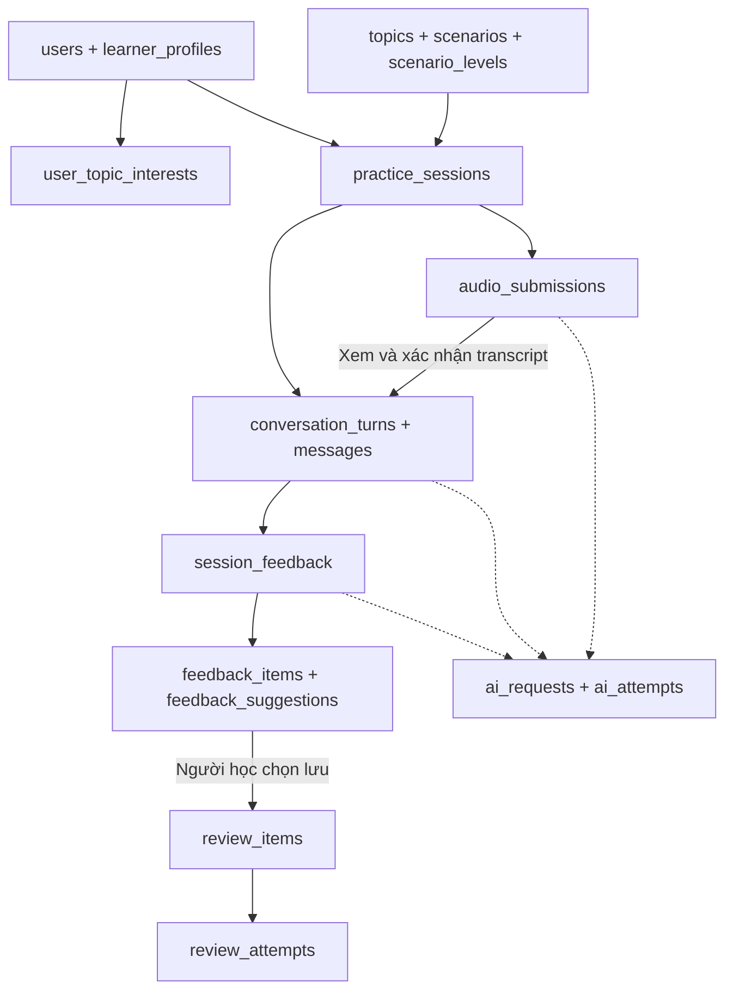

# Workflow và các bảng liên quan

Trạng thái: tài khoản, hồ sơ và catalog đã triển khai ở P1/P2; workflow hội thoại/feedback/ôn/lịch sử bên dưới vẫn là thiết kế. [ERD/ràng buộc](database.md) sở hữu chính sách dữ liệu; [dictionary](database-dictionary.md) sở hữu nghĩa trường. Các bước dưới đây không phải bằng chứng tính năng đã có.

## 1. Tài khoản và hồ sơ — AUTH-01 / PROFILE-01

1. Chuẩn hóa email, kiểm tra input và băm mật khẩu.
   ADR 0005 chốt trim đầu/cuối và không phân biệt hoa thường cho email; không chuẩn hóa mật khẩu theo cách đó. Xác minh email/quên mật khẩu để sau; đổi mật khẩu nằm trong bản đầu.
2. Tạo users và learner_profiles trong cùng transaction nếu cùng luồng đăng ký. UNIQUE(email) là hàng rào chống hai đăng ký đồng thời, không chỉ dùng truy vấn kiểm tra trước.
3. Ghi selected_level/mục tiêu; lưu từng chủ đề vào user_topic_interests sau khi kiểm tra topic hợp lệ.
4. Đăng nhập thành công mới cập nhật last_login_at. Đã chọn Session JDBC/MySQL tại [ADR 0004](../decisions/0004-session-authentication.md), đã triển khai runtime ở P1.

Luồng auth dự kiến: React lấy CSRF token → POST login → kiểm tra users/password/status → áp dụng chống session fixation, lưu SecurityContext → Spring Session ghi SPRING_SESSION/SPRING_SESSION_ATTRIBUTES và trả cookie HttpOnly. PRINCIPAL_NAME là chuỗi users.id để lookup, không FK. Request tiếp theo gửi cookie, backend kiểm tra phiên, status/role hiện hành và owner. Logout POST có CSRF → invalidate phiên hiện tại/xóa cookie. Khóa/đổi quyền/mật khẩu → revoke phiên cũ theo principal và bảo đảm request tiếp theo bị chặn. Anonymous CSRF session có thể tồn tại trước login, không được coi là đã xác thực. Không lưu session ID trong localStorage hoặc log.

Không tin role client gửi khi đăng ký; tài khoản công khai mặc định LEARNER. Profile và sở thích chỉ sửa được bởi owner; thay trình độ không sửa practice_sessions cũ.

Session idle 30 phút, nhiều thiết bị, logout phiên hiện tại theo ADR 0005. Admin đầu tiên tạo có chủ đích từ mật khẩu môi trường, không password seed cố định hoặc endpoint signup ADMIN; chạy lại không reset admin sẵn có.

## 2. Chọn bài và mở buổi — SCENARIO-01 / CHAT-01

1. Đọc topics/scenarios đang hoạt động, scenario_levels phù hợp A2/B1.
2. Kiểm tra người dùng chưa bị khóa. Tạo practice_sessions với owner, level và scenario_snapshot tại thời điểm chọn.
3. Tạo conversation_turns loại OPENING, turn_no 0, idempotency key server ổn định cho buổi; tạo ai_requests loại CHAT và liên kết tới lượt.
4. Commit transaction ngắn, kiểm tra/cấp hạn mức phù hợp, gọi provider và ghi ai_attempts.
5. Trong transaction mới, kiểm tra session/turn vẫn hợp lệ; lưu message ASSISTANT, hoàn tất turn/request/attempt.

Opening lỗi vẫn có buổi/lượt lỗi để thử lại có kiểm soát. Không tự tính hoàn thành chỉ vì đã tạo buổi.

## 3. Gửi văn bản và chống trùng — CHAT-01 / RESILIENCE-01

1. Xác thực và kiểm tra owner; khóa hàng session trong transaction ngắn. Kiểm tra ACTIVE và không có lượt khác đang chờ cần giải quyết.
   Chặn tạo lượt LEARNER thứ 21 theo ADR 0005. Câu đã lưu nhưng AI lỗi vẫn tính một lượt, retry cùng câu không tính thêm.
2. Tìm (session_id, client_request_id). Nếu có, đối chiếu fingerprint: nội dung khác → từ chối; nội dung giống → trả trạng thái/kết quả đang có, không tạo câu hoặc attempt mới chỉ vì HTTP retry.
3. Nếu mới: cấp turn_no, tạo turn và message LEARNER; tạo/đính ai_request CHAT. Kiểm tra/cấp hạn mức theo cơ chế nguyên tử được chọn trước khi gọi.
4. Commit, gọi Gemini ngoài transaction; lưu từng ai_attempt riêng để đo usage và latency.
5. Thành công: transaction lưu message ASSISTANT và trạng thái SUCCEEDED. Lỗi rõ: cập nhật FAILED và trả lỗi có thể xử lý. Kết quả chưa xác định: UNKNOWN, cần đối soát/chính sách hữu hạn trước retry.

Message LEARNER đã chấp nhận được giữ nếu AI thất bại. Retry xử lý trên cùng turn/request, tạo attempt mới khi thực sự gọi lại; không tạo thêm câu LEARNER. Operation key của AI là khóa tác vụ server, không mặc định bằng khóa HTTP của mọi bước.

Khi bí câu: yêu cầu HINT có owner/idempotency/quota, không chạy đồng thời lượt đang xử lý. ai_requests/ai_attempts ghi tác vụ và usage; response gợi ý chỉ hiển thị tạm, không thêm messages/turn hoặc tính vào 20 lượt. Chỉnh lỗi vẫn tập trung cuối buổi.

## 4. Giọng nói — VOICE-01 / PRIVACY-01

1. Người học nhận thông báo xử lý dữ liệu, ghi và nghe lại; backend kiểm tra MIME/codec/kích thước/thời lượng.
2. Tạo audio_submissions gắn session và hạn dữ liệu tạm. Chống trùng bằng (session_id, client_request_id).
3. Tạo ai_request TRANSCRIPTION, ghi ai_attempt; nhận và lưu draft_transcript với trạng thái READY. Chưa tạo message hoặc lượt CHAT từ bản chưa xác nhận.
4. Người học sửa rồi xác nhận. Backend khóa/kiểm tra audio vẫn thuộc đúng session, chưa dùng cho message khác và còn được phép xác nhận; kiểm tra idempotency của thao tác gửi câu.
5. Tạo turn LEARNER_AUDIO và message LEARNER/AUDIO với content cuối, gắn audio_submission_id; cập nhật confirmed_at/status. Thực hiện transaction nhất quán.
6. Tạo tác vụ CHAT riêng và tiếp tục workflow văn bản. Xóa transcript nháp khi không cần; dọn file độc lập với việc giữ nội dung tin nhắn cuối.

Hủy/không xác nhận không trở thành lượt học. Cùng audio chỉ dùng cho một message. Thời hạn cho phép xác nhận và hạn giữ file phải được làm rõ theo chính sách tạm, không tự coi mất file là mất câu cuối đã lưu.

## 5. Kết thúc và phản hồi — FEEDBACK-01

1. Khóa session, giải quyết lượt đang chờ trước khi đóng. Có ít nhất một câu LEARNER được chấp nhận và kết thúc bình thường → COMPLETED; bỏ dở/thoát không có câu → ABANDONED theo chính sách.
2. Tạo session_feedback PENDING theo UNIQUE(session_id), không đặt trạng thái thành công ngay. Session COMPLETED và feedback FAILED có thể đồng thời đúng.
3. Tạo ai_request FEEDBACK; gửi hội thoại cần thiết và snapshot, gọi ngoài transaction.
4. Validate JSON, kiểm tra source_message_id thuộc cùng buổi và sender LEARNER; original_text phải có trong câu nguồn. Phân biệt ERROR với IMPROVEMENT, cho phép không có lỗi.
5. Transaction lưu summary/strengths/goal, feedback_items và feedback_suggestions rồi đánh dấu SUCCEEDED. Nếu lỗi, rollback phần kết quả chưa hoàn chỉnh và cập nhật trạng thái lỗi bằng transaction phù hợp.
6. Retry bản thất bại giữ một feedback/request, thêm attempt. Không ghi đè feedback đã thành công hoặc làm hỏng nguồn review đã lưu.

Phân tích trả về sau xóa buổi phải bị từ chối, không tạo lại session/feedback. Thao tác end-session và create-feedback phải idempotent để double click không gọi AI trùng.

## 6. Lưu và ôn tập — REVIEW-01

1. Đọc feedback_suggestions, kiểm tra đường liên kết feedback → session → user là người đang đăng nhập.
2. Sao chép expression/meaning/example sang review_items thuộc user. UNIQUE(user_id, source_suggestion_id) giúp thao tác lưu lại cùng nguồn không tạo bản sao; không đặt UNIQUE(expression) toàn hệ thống.
3. Mở ôn, kiểm tra owner của review_item; bản đầu chỉ FLASHCARD. FILL_BLANK và lịch ôn tự động để sau theo ADR 0005.
4. Trong một transaction, tạo review_attempts và cập nhật status/last_reviewed_at/next_review_at của review_items.

Không cần giữ câu trả lời thô cho bài ôn đơn giản. Giữ bản sao thẻ khi xóa buổi theo chính sách; việc giữ không cấp lại quyền đọc lịch sử đã xóa.

## 7. Thống kê và cá nhân hóa — STATS-01 / PROFILE-01

- practice_sessions COMPLETED → số buổi hoàn thành.
- messages.LEARNER → số lượt đã chấp nhận/ngày luyện, không đếm opening/retry API.
- session_feedback SUCCEEDED + feedback_items.ERROR → nhóm lỗi theo category/rule_code được kiểm soát.
- review_items/review_attempts → nội dung cần ôn và lịch sử ôn.
- selected_level + user_topic_interests + lịch sử → gợi ý theo quy tắc đơn giản.

Sắp thứ tự hội thoại theo turn_no và sender, phân trang lịch sử theo started_at/id. Đổi UTC sang múi giờ thống kê trước khi nhóm ngày. Chưa cần bảng user_statistics; xóa dữ liệu nguồn sẽ thay đổi số liệu.

## 8. Quản trị — ADMIN-01

Backend kiểm tra ADMIN và trạng thái tài khoản → sửa users/topics/scenarios/scenario_levels → ghi admin_audit_logs cùng transaction. Để lưu tình huống ACTIVE, chủ đề phải đang mở và phải có ít nhất một trình độ. Sửa catalog giữ snapshot của buổi cũ. Khóa tài khoản tăng phiên bản bảo mật và thu hồi các phiên hiện có. Thống kê vận hành trả số tổng hợp, chi tiết hội thoại vẫn kiểm tra owner. [Hợp đồng ADMIN-01](../api/admin.md)

## 9. Xóa buổi và dọn dữ liệu — HISTORY-01 / PRIVACY-01

1. Kiểm tra owner, khóa session và ngăn kết quả worker muộn commit. Phân biệt tác vụ còn đang ở provider với dữ liệu ứng dụng có thể hủy.
2. Trong transaction: gỡ source_suggestion_id khỏi thẻ được giữ; xóa feedback_items/suggestions/feedback, messages và turns theo FK; gỡ session_id khỏi ai_requests.
3. Xóa draft_transcript của audio, chuyển DELETION_PENDING, gỡ liên kết session nhưng giữ file references cần dọn; sau đó xóa session. Không dựa vào SET NULL của FK ghép messages/audio.
4. Worker quét hàng audio còn lại, xóa local/provider idempotently và retry hữu hạn/có theo dõi khi lỗi. Chỉ bỏ reference của đích đã xử lý. Hoàn tất mọi đích thì đặt audio_deleted_at; tombstone không còn session có thể xóa.
5. Log metadata theo retention; không giữ transcript trong log để phục hồi lịch sử. Backup/provider có thời hạn riêng cần công bố.

Xóa toàn bộ dữ liệu học tập bao gồm cả review_items và review_attempts. Xóa tài khoản chưa thuộc chức năng đã chốt; cần chính sách riêng cho FK users, log và phiên trước khi thêm.

## 10. Kiểm tra cần có khi triển khai

Test owner/role, FK cùng buổi, hai yêu cầu đồng thời, key trùng khác payload, retry không tạo bản sao, audio chưa xác nhận, timeout UNKNOWN, feedback không có lỗi, review độc lập nguồn, xóa khi có worker muộn, cleanup thất bại và chạy lại. Dùng MySQL thật cho migration/FK; mock provider mặc định. Log sau gọi không thay thế cơ chế ngăn vượt quota trước gọi.
