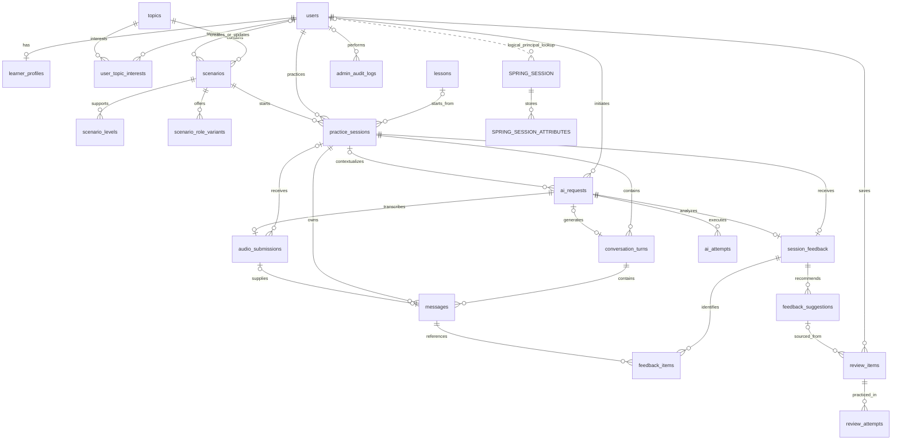
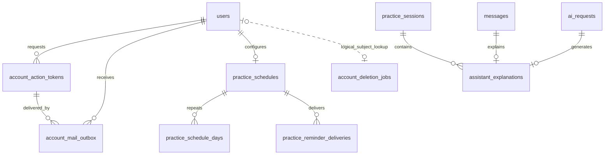
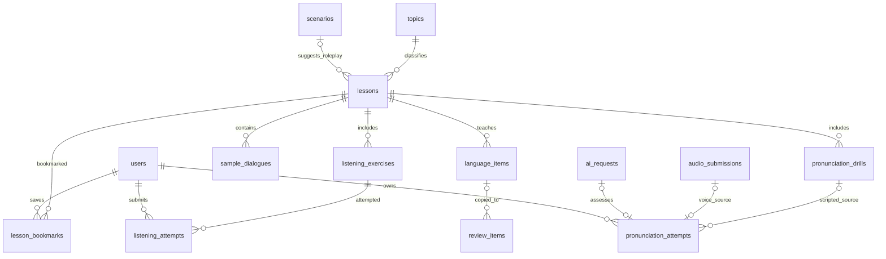
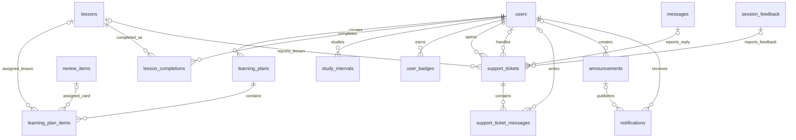

# Thiết kế MySQL toàn hệ thống — 46 bảng

G4 dùng Azure Speech Text to Speech F0 và MP3 mono 24 kHz, 48 kbps. G5 chọn Azure Pronunciation Assessment để chấm theo mẫu. G6 tích hợp chấm lời nói tự do theo lượt bằng Azure UNSCRIPTED khi được bật. [ADR 0014](../decisions/0014-azure-speech-tts-g4.md) · [ADR 0015](../decisions/0015-azure-pronunciation-assessment-g5.md)

Tài liệu này đặc tả trực tiếp schema khởi tạo trên database rỗng cho bản đầu của 10 nhóm chức năng. Danh mục gồm **46 bảng**, tính cả hai bảng Spring Session JDBC. Đây là thiết kế dữ liệu đầu vào để viết DDL và kiểm thử MySQL. Dữ liệu ví dụ là giả định.

[ERD](#2-erd-logic) · [Từ điển và dữ liệu mẫu](#3-từ-điển-46-bảng-và-dữ-liệu-mẫu) · [Khóa và điều phối](#4-quy-ước-khóa-và-điều-phối) · [Luồng dữ liệu](#6-luồng-dữ-liệu)

## 1. Phạm vi 10 nhóm chức năng

**Phạm vi phát âm thanh bản đầu.** Dùng TTS cho từ vựng, mẫu câu, hội thoại mẫu, đề nghe và câu mẫu shadowing. Học liệu công khai ở G3 dùng giọng tiếng Anh cục bộ của trình duyệt để đọc văn bản tiếng Anh. IPA hiển thị để tra cứu. G4 tổng hợp âm thanh phía backend cho đề nghe theo chính sách hiển thị kịch bản. Audio và video thu sẵn, cùng bảng `media_assets` và các FK tới bảng này, được hoãn. Quy trình thu âm của học viên để chép lời và chấm phát âm theo chính sách file tạm.

| Nhóm | Dữ liệu và phạm vi |
| --- | --- |
| 1. Tài khoản và hồ sơ | Dùng xác thực Session, token email, hồ sơ/ảnh đại diện, sở thích, lịch luyện và job xóa tài khoản. Mở rộng luồng xem và xóa dữ liệu cá nhân để xử lý các bảng mới. |
| 2. Khám phá nội dung | `lessons` theo một chủ đề và một cấp độ, có mã mục tiêu và tình huống gợi ý tùy chọn. Tìm theo từ khóa trên bài công khai, lọc theo chủ đề/cấp độ. `lesson_bookmarks` giữ yêu thích và học sau độc lập. |
| 3. Từ vựng, mẫu câu và hội thoại mẫu | `language_items` và `sample_dialogues` lưu văn bản để TTS đọc. IPA hỗ trợ học phát âm. Phụ đề hội thoại bám theo câu đang phát. Lưu bản sao để ôn qua `review_items` và `review_attempts`. |
| 4. Luyện nghe | `listening_exercises` dùng TTS phía backend. Nguồn thu sẵn thuộc giai đoạn sau. `listening_attempts` giữ đáp án nháp hoặc kết quả đã nộp, gồm điểm và giải thích từng câu. Hỗ trợ chọn đáp án, điền từ, sắp xếp và nghe–chép. |
| 5. Phát âm và ngữ điệu | `pronunciation_drills` định nghĩa bài đọc và shadowing. `pronunciation_attempts` giữ lần chấm, điểm toàn đoạn, từ và âm vị. Tệp người học quản lý theo TTL. Cho nghe lại bản ghi cục bộ trước khi gửi và nghe mẫu để luyện lại. |
| 6. Hội thoại AI | Dùng tình huống, vai, lượt, tin nhắn, giải thích, gợi ý, lịch sử và nhận xét. Lượt VOICE có thể dùng `pronunciation_attempts` để chấm nói tự do. Điểm giao tiếp, khi có rubric chốt, gắn vào bản `session_feedback`. |
| 7. Cá nhân hóa | `learning_plans` và `learning_plan_items` giữ kế hoạch ngày/tuần người học có thể chỉnh. Gợi ý dùng level, mục tiêu, sở thích, kết quả và thẻ đến hạn. Độ khó kế tiếp là gợi ý có thể bỏ qua. |
| 8. Tiến độ và động lực | `lesson_completions` giữ mốc hoàn thành, `study_intervals` giữ thời gian có tương tác, `user_badges` giữ huy hiệu đã trao. Tính số buổi, điểm thưởng theo quy tắc, chuỗi ngày, điểm nghe/nói/phát âm và lỗi thường gặp từ dữ liệu nguồn. Nhắc học qua lịch/email, thông báo kết quả qua `notifications`. Số nhiệm vụ lấy từ mục kế hoạch hoàn thành, số chủ đề dùng quy tắc bao phủ bài đã chốt. |
| 9. Hỗ trợ và phản hồi | `support_tickets` ghi phiếu kỹ thuật, phản hồi và báo cáo bài hoặc AI. `support_ticket_messages` lưu trao đổi và `notifications` hiển thị cập nhật. `announcements` giữ thông báo do admin tạo. |
| 10. Quản trị | Dùng `users` và cơ chế quyền/thu hồi phiên. Quản lý bài, từ/câu, tệp mẫu, tình huống, biến thể vai, phiếu và thông báo từ bảng nguồn. Dùng audit, log kỹ thuật và `ai_attempts` cho vận hành. Báo cáo tổng hợp trên dữ liệu nguồn. |

## 2. ERD logic

### Tài khoản, catalog, hội thoại và vận hành

`account_rate_limits` độc lập, nhận diện phạm vi giới hạn qua `bucket_key`. Các đường chấm chỉ là liên kết logic. `SPRING_SESSION.PRINCIPAL_NAME` dùng chuỗi ID tài khoản để tìm và thu hồi phiên. `account_deletion_jobs.subject_user_id` giữ dấu vết kỹ thuật sau khi xóa tài khoản. Bản audio có thể tạm gỡ liên kết buổi khi đang chờ dọn file.

### Tiến độ, hỗ trợ và thông báo

## 3. Từ điển 46 bảng và dữ liệu mẫu

Mỗi cột “Mẫu” biểu diễn một bản ghi của bảng. Ví dụ dùng học viên 42, admin 1 và bài **Chào hỏi và làm quen (A2)**. PK là khóa chính, FK là khóa ngoại, UQ là duy nhất và ? chỉ giá trị có thể để trống. V(n) là VARCHAR(n), DT là DATETIME(6) UTC, SCORE là DECIMAL(5,2) từ 0 đến 100, POINT là điểm theo thang đề. INT+ dùng cho vị trí dương. Các ID, giá trị băm, token giả lập và điểm chỉ nhằm minh họa.

### Tài khoản, phiên đăng nhập và lịch nhắc

#### `users`

Lưu danh tính và trạng thái bảo mật tài khoản. Backend cần một nguồn để xác thực, phân quyền và vô hiệu hóa phiên cũ.

Admin có ID 1. Job xóa minh họa một tài khoản khác là 43.

| Trường | Kiểu MySQL | Ý nghĩa và lý do lưu | Mẫu |
| --- | --- | --- | --- |
| `id` | BIGINT | Định danh tài khoản; API trả dạng chuỗi | `42` |
| `email` | VARCHAR(254) | Email đã chuẩn hóa và duy nhất. Dùng làm tên đăng nhập và địa chỉ cho email xác thực/khôi phục. | `learner42@example.invalid` |
| `password_hash` | VARCHAR(255) | Kết quả băm mật khẩu. PasswordEncoder dùng để kiểm tra khi đăng nhập. | `[BCrypt giả lập]` |
| `role` | VARCHAR(20) | LEARNER hoặc ADMIN; chưa cần bảng quyền động | `LEARNER` |
| `status` | VARCHAR(20) | ACTIVE hoặc LOCKED; phải kiểm tra thực tế ở backend/phiên | `ACTIVE` |
| `security_version` | BIGINT | Tăng khi đổi password/role/status; đối chiếu principal để chặn stale session sau revoke (ADR 0007) | `0` |
| `password_changed_at` | DATETIME(6) | Thời điểm đổi mật khẩu, hỗ trợ chính sách vô hiệu phiên | `NULL` |
| `last_login_at` | DATETIME(6) | Lần đăng nhập thành công gần nhất | `2026-11-24 08:00:00` |
| `created_at` | DATETIME(6) | Tạo tài khoản | `2026-11-24 08:00:00` |
| `updated_at` | DATETIME(6) | Cập nhật gần nhất | `2026-11-24 08:00:00` |
| `deletion_requested_at` | DATETIME(6) | Mốc yêu cầu xóa tài khoản. Filter và worker dựa vào đây để chặn thao tác mới khi đang dọn. | `NULL` |

#### `learner_profiles`

Giữ thiết lập học của học viên để cá nhân hóa catalog và mục tiêu học tập. Tách khỏi dữ liệu xác thực vì admin có thể không có hồ sơ.

| Trường | Kiểu MySQL | Ý nghĩa và lý do lưu | Mẫu |
| --- | --- | --- | --- |
| `user_id` | BIGINT | Một hồ sơ/người học; admin không bắt buộc có hồ sơ | `42` |
| `display_name` | VARCHAR(100) | Tên hiển thị để cá nhân hóa giao diện mà không dùng email làm nhãn. | `Minh (mẫu)` |
| `selected_level` | VARCHAR(2) | A2/B1 tự chọn; không phải kết quả đánh giá CEFR | `A2` |
| `learning_goal` | VARCHAR(1000) | Mục tiêu giao tiếp cá nhân | `Hỏi thăm và đáp lại lời chào.` |
| `daily_goal_minutes` | SMALLINT | Số phút mục tiêu mỗi ngày. Giao diện dùng làm mốc theo dõi thói quen học. | `15` |
| `created_at` | DATETIME(6) | Tạo hồ sơ | `2026-11-24 08:00:00` |
| `updated_at` | DATETIME(6) | Lần chỉnh hồ sơ gần nhất | `2026-11-24 08:00:00` |
| `avatar_storage_key` | CHAR(36) | Định danh nội bộ của file ảnh đại diện. Backend dùng để tìm và dọn file khi thay ảnh hoặc xóa tài khoản. | `NULL` |

#### `user_topic_interests`

Biểu diễn quan hệ nhiều–nhiều giữa người học và chủ đề. Xóa một lựa chọn không làm mất chủ đề.

| Trường | Kiểu MySQL | Ý nghĩa và lý do lưu | Mẫu |
| --- | --- | --- | --- |
| `user_id` | BIGINT | Người lựa chọn | `42` |
| `topic_id` | BIGINT | Chủ đề quan tâm; PK ghép user_id/topic_id | `10` |
| `created_at` | DATETIME(6) | Lúc chọn; bỏ quan tâm thì xóa hàng | `2026-11-24 08:00:00` |

#### `SPRING_SESSION`

Lưu phiên đăng nhập JDBC. Phiên còn hiệu lực qua nhiều request và có thể thu hồi theo người dùng.

| Trường | Kiểu MySQL | Ý nghĩa và lý do lưu | Mẫu |
| --- | --- | --- | --- |
| `PRIMARY_ID` | CHAR(36) | Khóa nội bộ bất biến để attributes tham chiếu | `00000000-0000-4000-8000-000000000001` |
| `SESSION_ID` | CHAR(36) | Định danh phiên có thể thay khi chống fixation; cookie opaque do thư viện ánh xạ, không tự coi giá trị cookie là raw DB ID | `00000000-0000-4000-8000-000000000002` |
| `CREATION_TIME` | BIGINT | Thời điểm tạo, epoch milliseconds | `1795507200000` |
| `LAST_ACCESS_TIME` | BIGINT | Truy cập gần nhất, epoch milliseconds | `1795507260000` |
| `MAX_INACTIVE_INTERVAL` | INT | Khoảng bất hoạt tối đa, đơn vị giây theo ngữ nghĩa thư viện | `1800` |
| `EXPIRY_TIME` | BIGINT | Mốc hết hạn, epoch milliseconds; có index phục vụ cleanup | `1795509060000` |
| `PRINCIPAL_NAME` | VARCHAR(100) | Lookup người dùng theo chuỗi users.id trong thiết kế principal; không FK, NULL được phép cho anonymous session | `42` |

#### `SPRING_SESSION_ATTRIBUTES`

Lưu từng thuộc tính của phiên. Spring Session đọc/ghi thuộc tính theo khóa riêng và dọn chúng cùng phiên.

| Trường | Kiểu MySQL | Ý nghĩa và lý do lưu | Mẫu |
| --- | --- | --- | --- |
| `SESSION_PRIMARY_ID` | CHAR(36) | Tham chiếu SPRING_SESSION.PRIMARY_ID, ON DELETE CASCADE | `00000000-0000-4000-8000-000000000001` |
| `ATTRIBUTE_NAME` | VARCHAR(200) | Tên thuộc tính; PK ghép SESSION_PRIMARY_ID/ATTRIBUTE_NAME | `SPRING_SECURITY_CONTEXT` |
| `ATTRIBUTE_BYTES` | BLOB | Giá trị thuộc tính được thư viện serialize, gồm context xác thực/CSRF khi cấu hình cần; không lưu entity JPA, credentials, key hoặc hội thoại | `[BLOB context giả lập]` |

#### `account_action_tokens`

Quản lý token đặt lại mật khẩu gửi qua email. Băm token và lưu thời hạn để kiểm tra dùng một lần.

| Trường | Kiểu MySQL | Ý nghĩa và lý do lưu | Mẫu |
| --- | --- | --- | --- |
| `id` | BIGINT | Khóa định danh riêng. Dùng tham chiếu chính xác bản ghi từ API hoặc bảng liên quan. | `8401` |
| `user_id` | BIGINT | ID tài khoản liên quan. Dùng xác định chủ sở hữu và lọc dữ liệu cá nhân. | `42` |
| `email` | VARCHAR(254) | Email chuẩn hóa của tài khoản. Token giữ email tại lúc phát hành để đối chiếu nếu địa chỉ thay đổi. | `learner42@example.invalid` |
| `token_hash` | CHAR(64) | Bản băm token hành động. Server đối chiếu mà không phải giữ token ở dạng rõ. | `[SHA-256 giả lập]` |
| `expires_at` | DATETIME(6) | Hạn hiệu lực xử lý. Giúp từ chối token quá hạn hoặc bỏ qua lần gửi đã hết hạn. | `2026-11-24 09:00:00` |
| `consumed_at` | DATETIME(6) | Mốc đã dùng token. Dùng để chặn tái sử dụng cùng token. | `2026-11-24 08:00:00` |
| `created_at` | DATETIME(6) | Mốc tạo bản ghi. Cần để sắp thứ tự, theo dõi tuổi bản ghi và phục vụ truy vết. | `2026-11-24 07:50:00` |

#### `account_mail_outbox`

Giữ email khôi phục mật khẩu chờ worker gửi, cho phép thử lại khi SMTP gián đoạn.

| Trường | Kiểu MySQL | Ý nghĩa và lý do lưu | Mẫu |
| --- | --- | --- | --- |
| `id` | BIGINT | Khóa định danh riêng. Dùng tham chiếu chính xác bản ghi từ API hoặc bảng liên quan. | `8402` |
| `user_id` | BIGINT | ID tài khoản liên quan. Dùng xác định chủ sở hữu và lọc dữ liệu cá nhân. | `42` |
| `action_token_id` | BIGINT | Token liên quan tới email. Worker dùng để đối chiếu hạn và trạng thái còn hiệu lực trước khi gửi. | `8401` |
| `encrypted_payload` | TEXT | Token gốc mã hóa để worker tạo liên kết gửi email. Dọn khi việc gửi kết thúc hoặc token không còn cần. | `NULL` |
| `status` | VARCHAR(20) | Trạng thái xử lý của bản ghi. Worker dùng để chọn việc hợp lệ và tránh lặp việc cuối. | `SENT` |
| `attempt_count` | INT | Số lần worker đã xử lý. Dùng để tính lịch thử lại và dừng khi đạt giới hạn. | `1` |
| `next_attempt_at` | DATETIME(6) | Thời điểm worker được xử lý lại. Dùng để sắp hàng đợi và tránh thử lại liên tục. | `2026-11-24 07:50:00` |
| `lease_until` | DATETIME(6) | Hạn giữ việc của worker. Cho phép khôi phục việc khi worker cũ đã mất lease. | `NULL` |
| `claim_token` | CHAR(36) | Mã nhận việc nội bộ. Dùng để chặn worker cũ ghi kết quả sau khi job đã được nhận lại. | `NULL` |
| `expires_at` | DATETIME(6) | Hạn hiệu lực xử lý. Giúp từ chối token quá hạn hoặc bỏ qua lần gửi đã hết hạn. | `2026-11-24 09:00:00` |
| `sent_at` | DATETIME(6) | Thời điểm gửi thành công. Cho phép phân biệt thư đã gửi với thư đang chờ. | `2026-11-24 07:50:02` |
| `error_code` | VARCHAR(50) | Mã lỗi kỹ thuật đã lọc. Dùng để phân loại lỗi và điều tra mà tránh ghi nội dung nhạy cảm. | `NULL` |
| `created_at` | DATETIME(6) | Mốc tạo bản ghi. Cần để sắp thứ tự, theo dõi tuổi bản ghi và phục vụ truy vết. | `2026-11-24 07:50:00` |

#### `account_rate_limits`

Giữ bộ đếm theo khóa băm và cửa sổ thời gian để hạn chế lạm dụng các thao tác tài khoản.

| Trường | Kiểu MySQL | Ý nghĩa và lý do lưu | Mẫu |
| --- | --- | --- | --- |
| `bucket_key` | CHAR(64) | Khóa SHA-256 của phạm vi giới hạn. Gom request cùng phạm vi mà không cần lưu email hoặc IP thô. | `[SHA-256 giả lập]` |
| `window_start` | DATETIME(6) | Mốc bắt đầu cửa sổ. Xác định thời điểm đặt lại bộ đếm. | `2026-11-24 07:50:00` |
| `last_request_at` | DATETIME(6) | Lần cập nhật bucket gần đây nhất. Dùng để dọn bucket đã hết nhu cầu. | `2026-11-24 07:51:00` |
| `request_count` | INT | Số request trong cửa sổ. So với giới hạn để quyết định từ chối hay tiếp nhận. | `2` |

#### `practice_schedules`

Giữ giờ luyện lặp lại theo múi giờ cá nhân. Lịch này dùng cho nhắc học.

| Trường | Kiểu MySQL | Ý nghĩa và lý do lưu | Mẫu |
| --- | --- | --- | --- |
| `id` | BIGINT | Khóa định danh riêng. Dùng tham chiếu chính xác bản ghi từ API hoặc bảng liên quan. | `8501` |
| `user_id` | BIGINT | ID tài khoản liên quan. Dùng xác định chủ sở hữu và lọc dữ liệu cá nhân. | `42` |
| `local_time` | TIME | Giờ luyện địa phương. Giữ giờ quen thuộc của người dùng khi quy đổi lịch gửi. | `19:30:00` |
| `time_zone` | VARCHAR(64) | Múi giờ IANA dùng quy đổi ngày và giờ của lịch thành thời điểm UTC. | `Asia/Ho_Chi_Minh` |
| `enabled` | BOOLEAN | Cờ bật lịch. Cho phép tắt lịch mà vẫn giữ cấu hình. | `true` |
| `email_reminder_enabled` | BOOLEAN | Lựa chọn nhận email. Cần tách khỏi việc bật lịch vì học viên có thể lưu lịch mà không nhận thư. | `true` |
| `version` | BIGINT | Phiên bản lịch. Worker dùng để phát hiện một lần gửi được tạo từ lịch cũ. | `1` |
| `created_at` | DATETIME(6) | Mốc tạo bản ghi. Cần để sắp thứ tự, theo dõi tuổi bản ghi và phục vụ truy vết. | `2026-11-24 08:00:00` |
| `updated_at` | DATETIME(6) | Mốc cập nhật gần nhất. Dùng để theo dõi thay đổi khi đọc hoặc vận hành. | `2026-11-24 08:00:00` |

#### `practice_schedule_days`

Giữ các ngày trong tuần của lịch. Khóa ghép chống chọn cùng ngày hai lần.

| Trường | Kiểu MySQL | Ý nghĩa và lý do lưu | Mẫu |
| --- | --- | --- | --- |
| `schedule_id` | BIGINT | Khóa của lịch mẹ. Dùng để tìm cấu hình và giới hạn ngày/lần gửi theo đúng lịch. | `8501` |
| `day_of_week` | INT | Ngày trong tuần từ 1 đến 7, thứ Hai là 1. Dùng để sinh lượt nhắc đúng ngày đã chọn. | `2` |

#### `practice_reminder_deliveries`

Theo dõi từng lần gửi theo thời điểm để chống gửi trùng, thử lại và bỏ qua lịch đã lỗi thời.

| Trường | Kiểu MySQL | Ý nghĩa và lý do lưu | Mẫu |
| --- | --- | --- | --- |
| `id` | BIGINT | Khóa định danh riêng. Dùng tham chiếu chính xác bản ghi từ API hoặc bảng liên quan. | `8502` |
| `schedule_id` | BIGINT | Khóa của lịch mẹ. Dùng để tìm cấu hình và giới hạn ngày/lần gửi theo đúng lịch. | `8501` |
| `schedule_version` | BIGINT | Phiên bản của lịch lúc tạo lượt nhắc. Dùng hủy lượt cũ nếu người dùng vừa sửa lịch. | `1` |
| `scheduled_for` | DATETIME(6) | Thời điểm UTC dự kiến gửi. Kết hợp với ID lịch để tránh sinh trùng. | `2026-11-24 12:30:00` |
| `expires_at` | DATETIME(6) | Hạn hiệu lực xử lý. Giúp từ chối token quá hạn hoặc bỏ qua lần gửi đã hết hạn. | `2026-11-24 13:30:00` |
| `status` | VARCHAR(20) | Trạng thái xử lý của bản ghi. Worker dùng để chọn việc hợp lệ và tránh lặp việc cuối. | `SENT` |
| `attempt_count` | INT | Số lần worker đã xử lý. Dùng để tính lịch thử lại và dừng khi đạt giới hạn. | `1` |
| `next_attempt_at` | DATETIME(6) | Thời điểm worker được xử lý lại. Dùng để sắp hàng đợi và tránh thử lại liên tục. | `2026-11-24 12:30:00` |
| `lease_until` | DATETIME(6) | Hạn giữ việc của worker. Cho phép khôi phục việc khi worker cũ đã mất lease. | `NULL` |
| `claim_token` | CHAR(36) | Mã nhận việc nội bộ. Dùng để chặn worker cũ ghi kết quả sau khi job đã được nhận lại. | `NULL` |
| `sent_at` | DATETIME(6) | Thời điểm gửi thành công. Cho phép phân biệt thư đã gửi với thư đang chờ. | `2026-11-24 12:30:03` |
| `error_code` | VARCHAR(50) | Mã lỗi kỹ thuật đã lọc. Dùng để phân loại lỗi và điều tra mà tránh ghi nội dung nhạy cảm. | `NULL` |
| `created_at` | DATETIME(6) | Mốc tạo bản ghi. Cần để sắp thứ tự, theo dõi tuổi bản ghi và phục vụ truy vết. | `2026-11-24 12:30:00` |

#### `account_deletion_jobs`

Theo dõi yêu cầu xóa qua nhiều bước và thử lại dọn tệp. Định danh kỹ thuật cho phép hoàn tất job khi đã xóa tài khoản.

| Trường | Kiểu MySQL | Ý nghĩa và lý do lưu | Mẫu |
| --- | --- | --- | --- |
| `id` | BIGINT | Khóa định danh riêng. Dùng tham chiếu chính xác bản ghi từ API hoặc bảng liên quan. | `8601` |
| `subject_user_id` | BIGINT | ID kỹ thuật của tài khoản cần xóa. Job giữ ID này để theo dõi tới lúc hoàn tất sau khi tài khoản mất. | `43` |
| `status` | VARCHAR(20) | Trạng thái xử lý của bản ghi. Worker dùng để chọn việc hợp lệ và tránh lặp việc cuối. | `COMPLETED` |
| `requested_at` | DATETIME(6) | Thời điểm nhận yêu cầu xóa. Dùng truy vết tuổi của việc đang chờ. | `2026-11-24 08:00:00` |
| `next_attempt_at` | DATETIME(6) | Thời điểm worker được xử lý lại. Dùng để sắp hàng đợi và tránh thử lại liên tục. | `2026-11-24 08:00:00` |
| `attempt_count` | INT | Số lần worker đã xử lý. Dùng để tính lịch thử lại và dừng khi đạt giới hạn. | `1` |
| `completed_at` | DATETIME(6) | Mốc job xóa hoàn thành. Giúp phân biệt đã dọn xong và còn việc phải làm. | `2026-11-24 08:02:00` |
| `error_code` | VARCHAR(50) | Mã lỗi kỹ thuật đã lọc. Dùng để phân loại lỗi và điều tra mà tránh ghi nội dung nhạy cảm. | `NULL` |

### Catalog, hội thoại và audio

#### `topics`

Định nghĩa danh mục chủ đề dùng chung giữa sở thích, tình huống và nội dung học. Một mã ổn định giúp lọc và quản trị.

| Trường | Kiểu MySQL | Ý nghĩa và lý do lưu | Mẫu |
| --- | --- | --- | --- |
| `id` | BIGINT | Định danh chủ đề | `10` |
| `code` | VARCHAR(50) | Mã ổn định, ví dụ TRAVEL | `INTRO` |
| `name` | VARCHAR(150) | Tên hiển thị tiếng Việt | `Làm quen` |
| `description` | TEXT | Giới thiệu | `Lời chào và giới thiệu.` |
| `is_active` | BOOLEAN | Cờ cho phép hiện và chọn chủ đề. Có thể ẩn chủ đề mà vẫn giữ tham chiếu cũ. | `true` |
| `admin_draft` | BOOLEAN | V19 đánh dấu chủ đề nháp tạo trong quản trị. Máy chủ bỏ cờ khi công bố lần đầu. Chỉ chủ đề có cờ này và chưa có tham chiếu mới xóa được. | `false` |
| `sort_order` | INT | Thứ tự, mặc định 0; phân xử bằng id khi trùng | `1` |
| `created_at` | DATETIME(6) | Mốc tạo bản ghi. Cần để sắp thứ tự, theo dõi tuổi bản ghi và phục vụ truy vết. | `2026-11-24 08:00:00` |
| `updated_at` | DATETIME(6) | Mốc cập nhật gần nhất. Dùng để theo dõi thay đổi khi đọc hoặc vận hành. | `2026-11-24 08:00:00` |

#### `scenarios`

Định nghĩa bối cảnh, vai và mục tiêu cho AI đóng vai. Dùng cùng một catalog cho người học và giao diện quản trị.

| Trường | Kiểu MySQL | Ý nghĩa và lý do lưu | Mẫu |
| --- | --- | --- | --- |
| `id` | BIGINT | Định danh tình huống | `21` |
| `topic_id` | BIGINT | Nhóm nội dung | `10` |
| `code` | VARCHAR(80) | Mã ổn định, ví dụ RESTAURANT_ORDER | `SELF_INTRODUCTION` |
| `title` | VARCHAR(200) | Tên bài luyện | `Làm quen ở câu lạc bộ` |
| `description` | TEXT | Giới thiệu cho người học | `Luyện hỏi thăm khi gặp lần đầu.` |
| `learner_role` | VARCHAR(200) | Vai người học | `Thành viên mới` |
| `ai_role` | VARCHAR(200) | Vai AI | `Người chào đón` |
| `communication_goal` | TEXT | Mục tiêu cần thực hành | `Hỏi thăm và giới thiệu bản thân.` |
| `context_description` | TEXT | Bối cảnh để hội thoại diễn ra | `Buổi gặp mặt câu lạc bộ.` |
| `ai_instruction` | TEXT | Chỉ dẫn phía server; không trả qua API danh sách | `Play a welcoming club member. Start with a greeting.` |
| `status` | VARCHAR(20) | DRAFT, ACTIVE, ARCHIVED | `ACTIVE` |
| `created_by` | BIGINT | Người tạo; nullable cho dữ liệu seed hoặc actor đã được xóa hợp lệ | `1` |
| `updated_by` | BIGINT | Người sửa gần nhất | `1` |
| `created_at` | DATETIME(6) | Mốc tạo bản ghi. Cần để sắp thứ tự, theo dõi tuổi bản ghi và phục vụ truy vết. | `2026-11-24 08:00:00` |
| `updated_at` | DATETIME(6) | Mốc cập nhật gần nhất. Dùng để theo dõi thay đổi khi đọc hoặc vận hành. | `2026-11-24 08:00:00` |

#### `scenario_levels`

Ghi các cấp độ khả dụng của từng tình huống. Backend dùng cặp này để lọc và kiểm tra khi mở buổi.

| Trường | Kiểu MySQL | Ý nghĩa và lý do lưu | Mẫu |
| --- | --- | --- | --- |
| `scenario_id` | BIGINT | Tình huống; PK ghép với level | `21` |
| `level` | VARCHAR(2) | A2 hoặc B1; ACTIVE phải có ít nhất một hàng | `A2` |

#### `scenario_role_variants`

Lưu cấu hình vai thay thế trong cùng tình huống. Mỗi vai có thể cần mục tiêu và chỉ dẫn riêng.

| Trường | Kiểu MySQL | Ý nghĩa và lý do lưu | Mẫu |
| --- | --- | --- | --- |
| `scenario_id` | BIGINT | Tình huống sở hữu biến thể. Dùng để lấy đúng lựa chọn vai trong catalog. | `21` |
| `code` | VARCHAR(32) | Mã biến thể trong tình huống. Dùng để tìm cấu hình ổn định khi người học chọn vai. | `REVERSE` |
| `learner_role` | VARCHAR(200) | Vai của học viên. Hiển thị để học viên biết mình cần đóng vai ai. | `Người chào đón` |
| `ai_role` | VARCHAR(200) | Vai đối diện của AI. Cần để định hướng câu mở đầu và các lượt trả lời. | `Thành viên mới` |
| `communication_goal` | TEXT | Mục tiêu riêng của vai. Dùng hướng dẫn học viên và làm căn cứ tổng kết. | `Chào và hỏi về sở thích.` |
| `context_description` | TEXT | Bối cảnh riêng của vai. Dùng để định vị cuộc hội thoại. | `Đón bạn mới đến câu lạc bộ.` |
| `ai_instruction` | TEXT | Chỉ dẫn nội bộ theo vai. Backend dùng để giữ AI đúng vai và không trả qua API người học. | `Play a new member and let the learner lead.` |

#### `practice_sessions`

Giữ một buổi luyện, chủ sở hữu, cấp độ và bản chụp nội dung. Lịch sử vẫn đọc đúng nếu catalog được chỉnh sửa.

| Trường | Kiểu MySQL | Ý nghĩa và lý do lưu | Mẫu |
| --- | --- | --- | --- |
| `id` | BIGINT | Định danh buổi | `7001` |
| `user_id` | BIGINT | Chủ sở hữu, kiểm tra server-side | `42` |
| `scenario_id` | BIGINT | Catalog nguồn; giữ FK bằng RESTRICT/ẩn catalog | `21` |
| `client_request_id` | VARCHAR(64) | Mã ổn định của thao tác từ client. Cho phép phát hiện gửi lại và tránh tạo thêm bản ghi cho cùng thao tác. | `open-demo-01` |
| `request_fingerprint` | CHAR(64) | Dấu vân tay có HMAC của đầu vào. Dùng để phát hiện cùng mã thao tác nhưng nội dung khác. | `[HMAC SHA-256 giả lập]` |
| `selected_level` | VARCHAR(2) | A2/B1 tại lúc bắt đầu; không đổi theo hồ sơ | `A2` |
| `scenario_snapshot` | JSON | Tên, vai, mục tiêu, bối cảnh và chỉ dẫn tại lúc mở buổi. Giữ đúng nội dung lịch sử và cách AI đóng vai dù tình huống được sửa. | `{"title":"Làm quen ở câu lạc bộ","learnerRole":"Thành viên mới","aiRole":"Người chào đón","goal":"Hỏi thăm và giới thiệu.","context":"Buổi gặp mặt câu lạc bộ.","instruction":"Play a welcoming club member. Start with a greeting."}` |
| `status` | VARCHAR(20) | ACTIVE, COMPLETED, ABANDONED | `COMPLETED` |
| `started_at` | DATETIME(6) | Bắt đầu | `2026-11-24 08:00:00` |
| `ended_at` | DATETIME(6) | Kết thúc bình thường hoặc bỏ dở; không trước started_at | `2026-11-24 08:18:00` |
| `last_activity_at` | DATETIME(6) | Hoạt động gần nhất, hỗ trợ nhận diện bỏ dở | `2026-11-24 08:18:00` |
| `version` | BIGINT | Giá trị optimistic lock, khởi tạo 0; không thay khóa giao dịch cấp lượt | `3` |
| `mode` | VARCHAR(5) | Chế độ đang dùng trong buổi, khởi tạo bằng chế độ người học chọn. | `VOICE` |
| `initial_mode` | VARCHAR(5) | Chế độ lúc tạo buổi để đối chiếu yêu cầu gửi lại sau khi chuyển sang TEXT. | `VOICE` |
| `role_code` | VARCHAR(32) | Mã vai chọn lúc tạo buổi. Dùng cùng bản chụp bối cảnh để giữ lựa chọn lịch sử và đối chiếu khi gửi lại. | `DEFAULT` |
| `lesson_id` | BIGINT? FK → lessons | Bài nguồn khi mở hội thoại từ bài; để trống khi mở trực tiếp. | `101` |

#### `conversation_turns`

Quản lý đơn vị xử lý lượt, thứ tự, hạn mức và chống gửi trùng. Một lượt có thể chứa nhiều tin nhắn và vẫn tồn tại khi AI lỗi.

| Trường | Kiểu MySQL | Ý nghĩa và lý do lưu | Mẫu |
| --- | --- | --- | --- |
| `id` | BIGINT | Định danh lượt | `7002` |
| `session_id` | BIGINT | Buổi sở hữu | `7001` |
| `turn_no` | INT | Opening 0, lượt người học 1 trở lên; UQ cùng session | `1` |
| `client_request_id` | VARCHAR(64) | ID thao tác từ client; server cấp cho opening; UQ cùng session | `turn-demo-01` |
| `request_fingerprint` | CHAR(64) | HMAC SHA-256 dạng hex của payload chuẩn hóa; ngăn tái sử dụng key khác nội dung | `[HMAC SHA-256 giả lập]` |
| `kind` | VARCHAR(20) | OPENING, LEARNER_TEXT, LEARNER_AUDIO | `LEARNER_AUDIO` |
| `status` | VARCHAR(20) | Trạng thái xử lý lượt. SKIPPED cho phép bỏ phản hồi đang lỗi mà vẫn giữ câu đã lưu. | `SUCCEEDED` |
| `ai_request_id` | BIGINT | Tác vụ CHAT xử lý lượt; chưa dispatch có thể NULL | `8001` |
| `processing_expires_at` | DATETIME(6) | Mốc lease cần kiểm tra lại; hết hạn không tự chứng minh provider chưa xử lý | `NULL` |
| `created_at` | DATETIME(6) | Tiếp nhận lượt | `2026-11-24 08:15:02` |
| `completed_at` | DATETIME(6) | Kết thúc xử lý; UNKNOWN có thể chưa có | `2026-11-24 08:15:04` |
| `version` | BIGINT | Optimistic lock; phối hợp cùng session lock | `1` |

#### `messages`

Lưu các câu đã chấp nhận cho transcript, ngữ cảnh và nhận xét. Khóa cùng buổi bảo vệ liên kết đến lượt và audio.

Tin nhắn AI cùng lượt có ID 7004, sender ASSISTANT, input_type GENERATED, audio_submission_id NULL và nội dung “I'm doing well, thanks.”

| Trường | Kiểu MySQL | Ý nghĩa và lý do lưu | Mẫu |
| --- | --- | --- | --- |
| `id` | BIGINT | Định danh tin nhắn | `7003` |
| `session_id` | BIGINT | Hỗ trợ truy vấn/FK cùng buổi; phải khớp turn | `7001` |
| `turn_id` | BIGINT | Lượt nguồn; UQ(turn_id, sender) | `7002` |
| `sender` | VARCHAR(20) | LEARNER hoặc ASSISTANT; không lưu system instruction như message người dùng | `LEARNER` |
| `content` | TEXT | Nội dung cuối được chấp nhận; giới hạn độ dài do API/service | `How are you?` |
| `input_type` | VARCHAR(20) | TEXT, AUDIO, GENERATED | `AUDIO` |
| `created_at` | DATETIME(6) | Lúc chấp nhận/lưu câu; không phải khóa thứ tự duy nhất | `2026-11-24 08:15:02` |
| `audio_submission_id` | BIGINT | Chỉ LEARNER/AUDIO; dùng FK ghép để khớp session | `7101` |

#### `audio_submissions`

Theo dõi file tạm và bản chép lời nháp qua vòng đời gửi, xác nhận và dọn file. Chỉ tin nhắn đã xác nhận đi vào transcript.

Ví dụ ở thời điểm xem lại. File tạm đã được dọn, còn metadata để liên kết với tin nhắn và kết quả chấm.

| Trường | Kiểu MySQL | Ý nghĩa và lý do lưu | Mẫu |
| --- | --- | --- | --- |
| `id` | BIGINT | Lần gửi âm thanh | `7101` |
| `session_id` | BIGINT | Bắt buộc khi sử dụng; chỉ NULL sau xóa buổi khi DELETION_PENDING | `7001` |
| `client_request_id` | VARCHAR(64) | Chống trùng upload trong session, độc lập key gửi câu CHAT | `audio-demo-01` |
| `request_fingerprint` | CHAR(64) | HMAC trên dấu vân tay của WAV để đối chiếu lần gửi lại | `[HMAC SHA-256 giả lập]` |
| `status` | VARCHAR(20) | TRANSCRIBING, READY, CONFIRMED, FAILED, EXPIRED, DELETION_PENDING | `CONFIRMED` |
| `ai_request_id` | BIGINT | Tác vụ TRANSCRIPTION | `8002` |
| `storage_key` | CHAR(36) | UUID file tạm local, giữ tới khi dọn thành công | `NULL` |
| `mime_type` | VARCHAR(32) | Kiểu file được kiểm tra nội dung, hiện dùng audio/wav | `audio/wav` |
| `size_bytes` | INT | Kích thước từ 46 đến 1.920.044 byte | `28844` |
| `duration_ms` | INT | Thời lượng > 0 được kiểm tra | `900` |
| `draft_transcript` | TEXT | Bản chép lời chưa xác nhận; dọn khi không cần/đã xóa buổi | `NULL` |
| `expires_at` | DATETIME(6) | TTL file audio: upload + 1 giờ theo ADR 0006; xóa sớm khi không còn cần, không phải retention provider | `2026-11-24 09:15:00` |
| `transcript_expires_at` | DATETIME(6) | Đặt READY + 30 phút cho transcript chưa xác nhận; khác TTL file. Xóa transcript khi xác nhận/hủy/kết thúc sớm hơn | `NULL` |
| `confirmed_at` | DATETIME(6) | Người học xác nhận nội dung cuối | `2026-11-24 08:15:02` |
| `audio_deleted_at` | DATETIME(6) | Thời điểm file tạm phía ứng dụng đã được dọn | `2026-11-24 08:15:05` |
| `created_at` | DATETIME(6) | Tiếp nhận | `2026-11-24 08:15:00` |

#### `assistant_explanations`

Lưu giải thích của một câu AI để tái sử dụng sau tải lại. Liên kết tách riêng giúp giải thích nằm ngoài transcript.

| Trường | Kiểu MySQL | Ý nghĩa và lý do lưu | Mẫu |
| --- | --- | --- | --- |
| `session_id` | BIGINT | Buổi có câu được giải thích. Dùng cùng ID tin nhắn để xác minh liên kết và quyền. | `7001` |
| `message_id` | BIGINT | Câu AI được giải thích. FK ghép với ID buổi để chống gắn nhầm câu. | `7004` |
| `ai_request_id` | BIGINT | Tác vụ AI xử lý bản ghi. Dùng để kiểm tra trạng thái, hạn mức và lịch sử lần gọi. | `8004` |
| `simple_english` | VARCHAR(400) | Cách diễn đạt tiếng Anh đơn giản hơn. Lưu để học viên xem lại khi mở buổi. | `I am doing well. Thank you.` |
| `meaning_vi` | VARCHAR(600) | Nghĩa tiếng Việt. Lưu để hiện theo yêu cầu ngay cả sau tải lại. | `Mình khỏe. Cảm ơn bạn.` |

### Nhận xét, ôn tập và vận hành

#### `session_feedback`

Giữ một bản tổng kết nội dung mỗi buổi. Trạng thái riêng cho phép hồi phục lỗi phân tích mà vẫn giữ hội thoại.

| Trường | Kiểu MySQL | Ý nghĩa và lý do lưu | Mẫu |
| --- | --- | --- | --- |
| `id` | BIGINT | Định danh phản hồi | `8201` |
| `session_id` | BIGINT | Tối đa một bản tổng hợp/buổi | `7001` |
| `ai_request_id` | BIGINT | Tác vụ FEEDBACK bắt buộc và duy nhất. Khi thử lại, hệ thống dùng cùng tác vụ và thêm lần gọi. | `8003` |
| `status` | VARCHAR(20) | Trạng thái tạo nhận xét, gồm UNKNOWN khi chưa rõ kết quả, để giao diện hiển thị và xác định cách hồi phục. | `SUCCEEDED` |
| `summary` | TEXT | Nhận xét chung; chưa có khi đang tạo | `Bạn đã hỏi thăm đúng ngữ cảnh.` |
| `strengths` | JSON | Mảng điểm làm tốt đã validate | `["Mở đầu bằng lời hỏi thăm."]` |
| `goal_assessment` | TEXT | Nhận xét mục tiêu tình huống; không phải điểm CEFR | `Đạt mục tiêu hỏi thăm.` |
| `next_practice` | TEXT | Gợi ý luyện tiếp | `Luyện hỏi lại về sở thích.` |
| `generated_at` | DATETIME(6) | Hoàn tất kết quả hợp lệ | `2026-11-24 08:18:02` |
| `created_at` | DATETIME(6) | Tạo bản ghi xử lý | `2026-11-24 08:18:00` |
| `updated_at` | DATETIME(6) | Cập nhật gần nhất | `2026-11-24 08:18:02` |
| `speaking_score` | SCORE? | Điểm giao tiếp nếu đã có rubric và đủ bằng chứng. Điểm phát âm nằm riêng theo lượt. | `85.00` |
| `speaking_rubric_version` | V(64)? | Phiên bản tiêu chí chấm giao tiếp để diễn giải và so sánh điểm. | `conversation-a2-v1` |

#### `feedback_items`

Lưu từng lỗi/gợi ý có nguồn câu cụ thể để giải thích, kiểm tra trích dẫn và tổng hợp lỗi lặp.

| Trường | Kiểu MySQL | Ý nghĩa và lý do lưu | Mẫu |
| --- | --- | --- | --- |
| `id` | BIGINT | Từng mục sửa/gợi ý | `8202` |
| `feedback_id` | BIGINT | Bản tổng hợp sở hữu | `8201` |
| `session_id` | BIGINT | Dùng trong hai FK ghép cùng feedback và source message | `7001` |
| `source_message_id` | BIGINT | Câu LEARNER nguồn phải cùng session | `7003` |
| `item_type` | VARCHAR(20) | ERROR hoặc IMPROVEMENT; không đếm improvement là lỗi | `IMPROVEMENT` |
| `category` | VARCHAR(20) | GRAMMAR, VOCABULARY, EXPRESSION | `EXPRESSION` |
| `rule_code` | VARCHAR(80) | Mã allowlist của backend cho nhóm lỗi chi tiết; AI không tự đặt taxonomy | `NULL` |
| `original_text` | TEXT | Đoạn trích phải kiểm tra có trong câu nguồn | `How are you?` |
| `suggested_text` | TEXT | Câu/đoạn sửa hoặc diễn đạt tốt hơn | `How are you doing?` |
| `explanation_vi` | TEXT | Giải thích cho người học | `Đây là cách hỏi thăm khác thường dùng trong hội thoại.` |
| `sort_order` | INT | Thứ tự hiển thị | `1` |

#### `feedback_suggestions`

Lưu các từ và mẫu câu AI đề xuất cho tổng kết. Học viên chọn mục cần sao chép thành thẻ.

| Trường | Kiểu MySQL | Ý nghĩa và lý do lưu | Mẫu |
| --- | --- | --- | --- |
| `id` | BIGINT | Định danh đề xuất ôn | `8203` |
| `feedback_id` | BIGINT | Nguồn đề xuất | `8201` |
| `item_type` | VARCHAR(20) | VOCABULARY hoặc PHRASE | `PHRASE` |
| `expression` | VARCHAR(200) | Từ/cụm từ/mẫu câu nên học | `How are you?` |
| `meaning_vi` | TEXT | Nghĩa/diễn giải tiếng Việt | `Bạn khỏe không?` |
| `example_en` | TEXT | Ví dụ tiếng Anh | `Hi, Mia. How are you?` |
| `sort_order` | INT | Thứ tự hiển thị | `1` |

#### `review_items`

Giữ nội dung thật sự được học viên lưu. Bản sao độc lập giúp thẻ vẫn dùng được sau khi nguồn bị xóa.

Ví dụ lưu thẻ 7201 từ gợi ý cuối buổi. Khi lưu từ kho, dùng nguồn học liệu và sao chép nội dung/IPA vào thẻ.

| Trường | Kiểu MySQL | Ý nghĩa và lý do lưu | Mẫu |
| --- | --- | --- | --- |
| `id` | BIGINT | Nội dung người học đã lưu | `7201` |
| `user_id` | BIGINT | Chủ sở hữu; không lấy quyền từ source_suggestion_id | `42` |
| `source_suggestion_id` | BIGINT | Nguồn tham khảo; SET NULL khi xóa lịch sử; UQ cùng user khi có giá trị | `8203` |
| `item_type` | VARCHAR(20) | VOCABULARY hoặc PHRASE | `PHRASE` |
| `expression` | VARCHAR(200) | Bản sao nội dung để độc lập nguồn | `How are you?` |
| `meaning_vi` | TEXT | Bản sao nghĩa tiếng Việt | `Bạn khỏe không?` |
| `example_en` | TEXT | Bản sao ví dụ | `Hi, Mia. How are you?` |
| `status` | VARCHAR(20) | NEEDS_REVIEW hoặc REMEMBERED | `REMEMBERED` |
| `last_reviewed_at` | DATETIME(6) | Lần ôn mới nhất | `2026-11-24 08:26:00` |
| `next_review_at` | DATETIME(6) | Mốc dự kiến dùng khi có lịch ôn tự động. G3 để trống. | `NULL` |
| `created_at` | DATETIME(6) | Người học lưu | `2026-11-24 08:19:00` |
| `updated_at` | DATETIME(6) | Cập nhật nội dung/trạng thái | `2026-11-24 08:26:00` |
| `source_language_item_id` | BIGINT? FK → language_items | Nguồn khi lưu từ kho; duy nhất theo người học và được gỡ khi xóa nguồn. | `NULL` |
| `ipa` | V(240)? | Bản sao phiên âm nếu nội dung nguồn có IPA. | `NULL` |

#### `review_attempts`

Lưu sự kiện ôn của từng thẻ để xem lại lịch sử và chống ghi trùng khi mạng chập chờn.

| Trường | Kiểu MySQL | Ý nghĩa và lý do lưu | Mẫu |
| --- | --- | --- | --- |
| `id` | BIGINT | Một lần ôn | `7202` |
| `review_item_id` | BIGINT | Thẻ được ôn; user suy ra qua thẻ | `7201` |
| `review_mode` | VARCHAR(20) | FLASHCARD dùng tự đánh dấu. QUICK_QUIZ dùng chọn nghĩa tiếng Việt, chấm phía backend. | `FLASHCARD` |
| `result` | VARCHAR(20) | Trạng thái thẻ sau lượt ôn, REMEMBERED hoặc NEEDS_REVIEW. Flashcard lưu lựa chọn mới, quiz ghi lại trạng thái hiện có. | `REMEMBERED` |
| `client_request_id` | VARCHAR(64) | Mã ổn định của thao tác từ client. Cho phép phát hiện gửi lại và tránh tạo thêm bản ghi cho cùng thao tác. | `review-demo-01` |
| `request_fingerprint` | CHAR(64)? | SHA-256 của chế độ và nội dung thao tác. Giúp phân biệt gửi lại nguyên vẹn với dùng lại mã cho đáp án khác. Có thể trống ở dữ liệu cũ. | `[SHA-256 của yêu cầu]` |
| `reviewed_at` | DATETIME(6) | Thời điểm ôn; không bắt buộc giữ câu trả lời thô | `2026-11-24 08:26:00` |
| `is_correct` | BOOLEAN? | Đúng/sai do server chấm trong QUICK_QUIZ; để trống với FLASHCARD. | `NULL` |

#### `ai_requests`

Ghi tác vụ AI logic để quản lý quota, chống trùng và theo dõi kết quả. Một tác vụ có thể dẫn tới nhiều lần gọi.

Các tác vụ cùng buổi minh họa gồm 8002 (TRANSCRIPTION cho audio 7101), 8003 (FEEDBACK cho tổng kết 8201) và 8004 (EXPLAIN cho câu AI 7004). Các mã 8101 và 8102 dành cho PRONUNCIATION, lần lượt cho lượt hội thoại và bài đọc mẫu.

| Trường | Kiểu MySQL | Ý nghĩa và lý do lưu | Mẫu |
| --- | --- | --- | --- |
| `id` | BIGINT | Tác vụ nghiệp vụ logic, không phải một HTTP attempt | `8001` |
| `user_id` | BIGINT | Người phát sinh usage; xóa tài khoản cần chính sách riêng | `42` |
| `session_id` | BIGINT | Bối cảnh; SET NULL khi xóa buổi, không giữ nội dung trong log | `7001` |
| `task_type` | VARCHAR(20) | Loại tác vụ CHAT, HINT, TRANSCRIPTION, FEEDBACK, EXPLAIN hoặc PRONUNCIATION. Dùng chọn luồng xử lý, quota và thống kê. | `CHAT` |
| `operation_key` | VARCHAR(128) | Khóa do server tạo/chuẩn hóa ổn định; UQ cùng user và task | `chat:7001:1` |
| `request_fingerprint` | CHAR(64) | Dấu vân tay có HMAC của đầu vào. Dùng để phát hiện cùng mã thao tác nhưng nội dung khác. | `[HMAC SHA-256 giả lập]` |
| `status` | VARCHAR(20) | PENDING, RUNNING, SUCCEEDED, FAILED, UNKNOWN | `SUCCEEDED` |
| `prompt_version` | VARCHAR(80) | Phiên bản template/hướng dẫn, không phải prompt có transcript | `chat-v1` |
| `attempt_count` | INT | Số lần worker đã xử lý. Dùng để tính lịch thử lại và dừng khi đạt giới hạn. | `1` |
| `retryable` | BOOLEAN | Cho biết lỗi được phép thử lại. Giúp worker và API phân biệt lỗi tạm với lỗi cuối. | `false` |
| `error_code` | VARCHAR(100) | Mã lỗi kỹ thuật đã lọc. Dùng để phân loại lỗi và điều tra mà tránh ghi nội dung nhạy cảm. | `NULL` |
| `retry_not_before` | DATETIME(6) | Mốc sớm nhất được phép retry. Dùng để thực hiện thời gian chờ giữa các lần. | `NULL` |
| `processing_expires_at` | DATETIME(6) | Mốc hết lease xử lý. Cho phép phát hiện worker bị treo và xử lý trạng thái chưa rõ. | `NULL` |
| `created_at` | DATETIME(6) | Tiếp nhận tác vụ | `2026-11-24 08:15:02` |
| `finished_at` | DATETIME(6) | Kết thúc tác vụ | `2026-11-24 08:15:04` |
| `busy_session_id` | BIGINT · cột sinh | Cột sinh từ trạng thái tác vụ. UNIQUE trên tác vụ hội thoại đang bận của buổi. PRONUNCIATION dùng điều phối riêng và không chiếm khóa này. | `NULL` |

#### `ai_attempts`

Theo dõi từng lần gọi dịch vụ để phân tích retry, độ trễ, usage và chi phí ước tính.

| Trường | Kiểu MySQL | Ý nghĩa và lý do lưu | Mẫu |
| --- | --- | --- | --- |
| `id` | BIGINT | Lần gọi provider | `8011` |
| `ai_request_id` | BIGINT | Tác vụ sở hữu | `8001` |
| `attempt_no` | INT | Tăng từ 1, UQ cùng ai_request | `1` |
| `model_name` | VARCHAR(150) | Model thực tế, không suy từ config hiện tại sau này | `gemini-demo-model` |
| `status` | VARCHAR(20) | RUNNING, SUCCEEDED, FAILED, UNKNOWN | `SUCCEEDED` |
| `provider_request_id` | VARCHAR(255) | ID provider nếu API có, không giả định provider idempotency | `NULL` |
| `input_tokens` | BIGINT | Token đầu vào được báo; chưa biết để NULL | `420` |
| `output_tokens` | BIGINT | Token đầu ra được báo; chưa biết để NULL | `35` |
| `latency_ms` | BIGINT | Thời gian của attempt, không phải tổng thời gian người học | `920` |
| `estimated_cost` | DECIMAL(18,8) | Ước tính USD theo quy ước thiết kế; không phải hóa đơn và không gán 0 khi chưa biết | `NULL` |
| `pricing_reference` | VARCHAR(255) | Revision/thời điểm/bảng giá dùng tính USD; cần đủ căn cứ hoặc để cost NULL | `NULL` |
| `error_code` | VARCHAR(100) | Mã lỗi an toàn; không chứa response/prompt thô | `NULL` |
| `started_at` | DATETIME(6) | Bắt đầu gọi | `2026-11-24 08:15:02` |
| `finished_at` | DATETIME(6) | Kết thúc hoặc timeout | `2026-11-24 08:15:03` |
| `provider` | V(32) | Nhà cung cấp của lần gọi để theo dõi lỗi và mức sử dụng. | `GEMINI` |

#### `admin_audit_logs`

Truy vết ai đã thao tác trên đối tượng nào và lúc nào. Audit hỗ trợ điều tra mà chỉ giữ metadata cần thiết.

| Trường | Kiểu MySQL | Ý nghĩa và lý do lưu | Mẫu |
| --- | --- | --- | --- |
| `id` | BIGINT | Sự kiện quản trị | `8301` |
| `actor_user_id` | BIGINT | Người thực hiện; nullable khi có chính sách xóa actor phù hợp | `1` |
| `action` | VARCHAR(80) | USER_ACCESS_UPDATED, TOPIC_CREATED, TOPIC_UPDATED, SCENARIO_CREATED hoặc SCENARIO_UPDATED | `SCENARIO_UPDATED` |
| `target_type` | VARCHAR(40) | Loại đối tượng bị tác động | `SCENARIO` |
| `target_id` | BIGINT | ID đối tượng lịch sử; không phải FK đa hình tới nhiều bảng | `21` |
| `safe_metadata` | JSON | Dữ liệu truy vết đã lọc, không chứa hội thoại/mật khẩu/key/PII không cần thiết | `NULL` |
| `created_at` | DATETIME(6) | Lúc thao tác thành công | `2026-11-24 01:00:00` |

### Bài học, học liệu và sổ tay

#### `lessons`

Là đơn vị người học tìm, lưu dấu và hoàn thành. Một ID ổn định cho phép cập nhật thông tin hiển thị mà vẫn giữ dấu trang và tiến độ.

Công khai bài theo một cấp độ và một chủ đề đang hoạt động. Nếu có tình huống gợi ý, backend kiểm tra cấp độ bài nằm trong `scenario_levels` trước khi công khai. Khi tình huống gợi ý bị ẩn sau đó, giữ liên kết để bảo toàn tham chiếu và bỏ thao tác mở tình huống khỏi DTO học viên. Tìm từ khóa theo `title` và `summary`, hỗ trợ tiếng Việt không dấu và không phân biệt hoa thường.

| Trường | Kiểu và ràng buộc | Ý nghĩa và lý do lưu | Mẫu |
| --- | --- | --- | --- |
| `id` | BIGINT PK | Định danh bài để liên kết nội dung, dấu trang, kế hoạch và tiến độ. | `101` |
| `topic_id` | BIGINT FK → topics | Chủ đề của bài để lọc và tổng hợp số bài theo chủ đề. | `10` |
| `level` | V(2) | Cấp độ A2 hoặc B1. Dùng lọc bài và kiểm tra tương thích với tình huống gợi ý. | `A2` |
| `scenario_id` | BIGINT? FK ghép cùng `level` → scenario_levels | Tình huống gợi ý mở từ bài cùng cấp độ. Để trống nếu bài chỉ gồm học liệu và bài tập. | `21` |
| `title` | V(200) | Tên hiển thị và tìm kiếm của bài. | `Chào hỏi và làm quen` |
| `summary` | TEXT | Mô tả ngắn trước khi mở bài, dùng hỗ trợ tìm theo từ khóa. | `Luyện mở đầu cuộc gặp.` |
| `objective_code` | V(64) | Mã mục tiêu ổn định để lọc và gợi ý bài tương ứng. | `GREET_AND_RESPOND` |
| `learning_objective` | TEXT | Mục tiêu diễn giải cho người học biết cần đạt kỹ năng gì. | `Hỏi thăm và đáp lại lời chào.` |
| `status` | V(16) | DRAFT, ACTIVE hoặc ARCHIVED. Mở bài công khai khi ACTIVE và nội dung đã qua validation. | `ACTIVE` |
| `created_at` | DT | Thời điểm tạo định danh bài. | `2026-11-24 01:00:00` |
| `updated_at` | DT | Mốc thay đổi nội dung hoặc trạng thái, dùng theo dõi cập nhật quản trị. | `2026-11-24 01:30:00` |

#### `lesson_bookmarks`

Giữ lựa chọn yêu thích hoặc học sau của từng người, với hai loại dấu độc lập.

Khóa ghép `(user_id, lesson_id, kind)` cho phép một người đánh cả FAVORITE và SAVE_FOR_LATER cho cùng bài. Quyền đọc và ghi theo `user_id`. Ẩn bài giữ các dòng bookmark để chủ sở hữu có thể bỏ dấu. Danh sách đã lưu biểu thị bài không còn khả dụng và giữ kín nội dung bài ẩn.

| Trường | Kiểu và ràng buộc | Ý nghĩa và lý do lưu | Mẫu |
| --- | --- | --- | --- |
| `user_id` | BIGINT PK/FK → users | Chủ của dấu trang. | `42` |
| `lesson_id` | BIGINT PK/FK → lessons | Bài được đánh dấu, dùng mở lại từ danh sách yêu thích hoặc học sau. | `101` |
| `kind` | V(20) PK | FAVORITE hoặc SAVE_FOR_LATER. Một người có thể đặt cả hai cho cùng bài. | `FAVORITE` |
| `created_at` | DT | Thời điểm đánh dấu lần đầu của loại này. | `2026-11-24 08:00:00` |

#### `language_items`

Lưu từ/câu bên trong bài để biên tập, tìm và lưu ôn theo từng mục. Thẻ cá nhân giữ bản sao độc lập.

TTS cục bộ của trình duyệt đọc `expression`, ưu tiên giọng `en-US` rồi chọn giọng tiếng Anh cục bộ sẵn có. `ipa` phục vụ tra cứu. Ví dụ, bấm **Nghe** cho `How are you?` để phát giọng tổng hợp trực tiếp từ văn bản.

Chủ đề lấy từ `lessons.topic_id`. Khi lưu vào sổ tay, sao chép nội dung sang `review_items` để còn ôn sau khi nguồn bị ẩn hoặc gỡ.

| Trường | Kiểu và ràng buộc | Ý nghĩa và lý do lưu | Mẫu |
| --- | --- | --- | --- |
| `id` | BIGINT PK | Định danh một mục học liệu cụ thể. | `3101` |
| `lesson_id` | BIGINT FK → lessons | Bài sở hữu mục từ. Dùng để lấy danh sách theo bài và suy ra chủ đề. | `101` |
| `kind` | V(10) | WORD hoặc PHRASE. | `PHRASE` |
| `expression` | V(200) | Từ hoặc cụm/câu tiếng Anh hiển thị. | `How are you?` |
| `ipa` | V(240)? | Phiên âm tham khảo do nội dung biên tập. NULL khi chưa có. | `haʊ ɑɹ ju` |
| `meaning_vi` | TEXT | Nghĩa tiếng Việt theo ngữ cảnh. | `Bạn khỏe không?` |
| `example_en` | TEXT? | Ví dụ tiếng Anh. | `Hi, Mia. How are you?` |
| `example_vi` | TEXT? | Bản dịch của ví dụ, nếu biên tập. | `Chào Mia. Bạn khỏe không?` |
| `sort_order` | INT+ | Vị trí từ/câu trong bài để danh sách nhất quán khi hiển thị. | `1` |
| `status` | V(16) | DRAFT, ACTIVE hoặc ARCHIVED. | `ACTIVE` |
| `created_at` | DT | Lần tạo mục. | `2026-11-24 01:10:00` |
| `updated_at` | DT | Lần cập nhật bản nháp hoặc trạng thái gần nhất. | `2026-11-24 01:20:00` |

#### `sample_dialogues`

Giữ một đoạn hội thoại biên soạn trước để học viên nghe, xem lời thoại và bản dịch. Các câu được đọc cùng đoạn nên nằm trong một trường JSON.

TTS cục bộ đọc `text_en` từng câu theo thứ tự. Giao diện đánh dấu câu đang phát, mặc định hiện lời Anh và ẩn bản dịch. Hai phần bật/tắt độc lập. `voice_key` là tùy chọn để chọn giọng cục bộ phù hợp khi có. Nếu thiết bị chỉ có một giọng tiếng Anh, giọng đó phục vụ cả hai vai.

G3 kiểm tra các đoạn mẫu gồm 4–6 lượt, hai nhãn vai, số thứ tự liền nhau từ 1 và văn bản Anh–Việt hợp lệ. Mã giọng có thể để trống hoặc dùng `en-us-voice-a-v1`, `en-us-voice-b-v1`.

| Trường | Kiểu và ràng buộc | Ý nghĩa và lý do lưu | Mẫu |
| --- | --- | --- | --- |
| `id` | BIGINT PK | Định danh đoạn dùng cho xem transcript hoặc nghe mẫu. | `4101` |
| `lesson_id` | BIGINT FK → lessons | Bài trình bày đoạn hội thoại, dùng để tải nội dung liên quan. | `101` |
| `title` | V(200) | Tên đoạn, ví dụ “Đặt món ở quán cà phê”. | `Chào bạn mới gặp` |
| `lines_json` | JSON | Mảng câu theo thứ tự, có người nói, văn bản để đọc, bản dịch và mã giọng tùy chọn. | `[{"line_no":1,"speaker_label":"Mia","text_en":"Hi! What’s your name?","text_vi":"Chào bạn! Bạn tên gì?","voice_key":"en-us-voice-a-v1"},{"line_no":2,"speaker_label":"Leo","text_en":"I’m Leo.","text_vi":"Mình là Leo.","voice_key":"en-us-voice-b-v1"},{"line_no":3,"speaker_label":"Mia","text_en":"What do you like doing?","text_vi":"Bạn thích làm gì?"},{"line_no":4,"speaker_label":"Leo","text_en":"I like drawing.","text_vi":"Mình thích vẽ."}]` |
| `sort_order` | INT+ | Thứ tự các đoạn trong bài. | `1` |
| `status` | V(16) | DRAFT, ACTIVE hoặc ARCHIVED. Tách nội dung đang soạn khỏi đoạn hiện cho người học. | `ACTIVE` |
| `created_at` | DT | Thời điểm tạo để truy vết lần tiếp nhận và sắp xếp dữ liệu. | `2026-11-24 01:00:00` |
| `updated_at` | DT | Lần chỉnh gần nhất để theo dõi cập nhật nội dung và trạng thái. | `2026-11-24 01:30:00` |

### Luyện nghe

#### `listening_exercises`

Giữ đề nghe với audio, quy tắc hiển thị và bộ câu hỏi được chấm cùng nhau. Một đề có thể nhận nhiều lượt làm.

Mã câu và mã lựa chọn chỉ cần ổn định trong đề. Khi có lượt làm, thay đổi nội dung ảnh hưởng cách chấm bằng cách tạo đề mới và ẩn đề cũ. API trước khi nộp không trả đáp án hoặc phần bị giới hạn theo `transcript_policy`.

| Trường | Kiểu và ràng buộc | Ý nghĩa và lý do lưu | Mẫu |
| --- | --- | --- | --- |
| `id` | BIGINT PK | Định danh đề nghe. | `5101` |
| `lesson_id` | BIGINT FK → lessons | Bài học chứa đề để học viên mở đúng hoạt động nghe. | `101` |
| `tts_voice_key` | V(64) | Mã giọng mặc định của đề. Với đoạn nhiều vai, giọng từng lượt lấy từ `script_segments_json`. | `en-us-voice-a-v1` |
| `title` | V(200) | Tên bài nghe. | `Nghe lời chào đầu tiên` |
| `instructions` | TEXT | Mô tả thao tác, ví dụ nghe và điền từ vào chỗ trống. | `Nghe đoạn hội thoại và chọn câu đầu tiên.` |
| `transcript_en` | TEXT | Kịch bản tiếng Anh khác rỗng, trả theo `transcript_policy`. Với đề nhiều vai, văn bản hiển thị phải khớp lời các lượt dùng để sinh audio. | `How are you? I'm good, thanks.` |
| `script_segments_json` | JSON? | Danh sách đoạn của đề nhiều vai, gồm `line_no`, `speaker_label`, `text_en`, `voice_key`. Backend kiểm tra thứ tự, giọng và thoát ký tự XML trước khi tạo SSML. Đề một giọng có thể để `NULL`. | `[{"line_no":1,"speaker_label":"Mia","text_en":"How are you?","voice_key":"en-us-voice-a-v1"},{"line_no":2,"speaker_label":"Leo","text_en":"I'm good, thanks.","voice_key":"en-us-voice-b-v1"}]` |
| `translation_vi` | TEXT? | Nghĩa tiếng Việt khi có. | `Bạn khỏe không? Mình khỏe, cảm ơn.` |
| `transcript_policy` | V(20) | G4 dùng AFTER_SUBMIT. Server chỉ công bố lời thoại sau khi đã nộp lượt. | `AFTER_SUBMIT` |
| `questions_json` | JSON | Giữ mã và loại câu, câu hỏi, lựa chọn, các đáp án hợp lệ và giải thích để server chấm. Mỗi câu tối đa 1 điểm. | `[{"code":"q1","type":"MULTIPLE_CHOICE","prompt":"Mia hỏi gì?","options":[{"code":"A","text":"Sức khỏe"},{"code":"B","text":"Tên"}],"accepted":["A"],"explanationVi":"Mia hỏi thăm ở đầu đoạn."}]` |
| `status` | V(16) | DRAFT, ACTIVE hoặc ARCHIVED. Chỉ ACTIVE khi nội dung hợp lệ và MP3 sẵn sàng phát. ARCHIVED chặn lượt mới, vẫn cho tiếp tục lượt cũ và xem lịch sử. | `ACTIVE` |
| `sort_order` | INT+ | Vị trí đề trong bài học. | `1` |
| `created_at` | DT | Thời điểm tạo để truy vết lần tiếp nhận và sắp xếp dữ liệu. | `2026-11-24 01:00:00` |
| `updated_at` | DT | Lần chỉnh gần nhất để theo dõi cập nhật nội dung và trạng thái. | `2026-11-24 01:30:00` |

**Luồng đề TTS 5101.** Khi chuẩn bị công khai, backend tổng hợp MP3 bằng Azure Speech F0, kiểm tra tệp và lưu vào thư mục riêng theo ID phiên bản đề. API phục vụ audio sau khi kiểm tra quyền truy cập lượt. Giữ MP3 của phiên bản đề cũ để người học tiếp tục lượt đang làm. Khi mở đề, nghe lại hoặc làm lại, dùng tệp đã tạo. Với `AFTER_SUBMIT`, trước nộp chỉ trả audio, nội dung câu hỏi được phép hiển thị và nháp của chủ sở hữu lượt. Sau nộp trả thêm lời thoại, bản dịch nếu có, đáp án và giải thích.

#### `listening_attempts`

Một bản ghi cho mỗi lần làm của người học. Dữ liệu nộp và điểm đã chấm được đọc cùng nhau để xem lại và theo dõi tiến độ.

UNIQUE theo `(user_id, client_request_id)` để chống tạo lặp. Backend bảo đảm tối đa một lượt `IN_PROGRESS` cho mỗi cặp `(user_id, exercise_id)`, kể cả khi mở đồng thời từ hai thiết bị. Lưu nháp kiểm tra trạng thái và `draft_version` cùng thao tác cập nhật. Khi nộp lần đầu, server kiểm tra phiên bản nháp, chấm theo đề của lượt và lưu trạng thái, đáp án và điểm trong cùng giao dịch. Với lượt đã nộp, đối chiếu nội dung yêu cầu với đáp án đã lưu để trả kết quả cũ nếu trùng hoặc `409` nếu khác. Khi thay đề, lượt cũ tiếp tục tham chiếu `exercise_id` ban đầu.

| Trường | Kiểu và ràng buộc | Ý nghĩa và lý do lưu | Mẫu |
| --- | --- | --- | --- |
| `id` | BIGINT PK | Định danh lần làm. | `5131` |
| `user_id` | BIGINT FK → users | Người làm và chủ sở hữu lịch sử. | `42` |
| `exercise_id` | BIGINT FK → listening_exercises | Đề thực tế của lần làm. | `5101` |
| `client_request_id` | V(64) | Mã yêu cầu chống tạo trùng, duy nhất trong phạm vi user. | `listen-demo-01` |
| `status` | V(16) | IN_PROGRESS, SUBMITTED hoặc ABANDONED. | `SUBMITTED` |
| `score` | POINT? | Tổng điểm sau nộp. NULL trước nộp. | `1` |
| `max_score` | POINT | Tổng điểm tối đa của đề cho lần làm này. | `1` |
| `answers_json` | JSON | Khi đang làm, giữ bản đồ mã câu tới câu trả lời nháp. Sau khi nộp, lưu mảng kết quả với đáp án người học, đáp án hợp lệ, điểm và giải thích từng câu. | Nháp `{"q1":"A"}`. Đã nộp `[{"questionCode":"q1","answerValue":"A","pointsAwarded":1,"accepted":["A"],"explanationVi":"Mia hỏi thăm ở đầu đoạn."}]` |
| `draft_version` | INT | Bắt đầu từ 0, tăng sau mỗi lần lưu nháp thành công. API trả `409` khi phiên bản client gửi đã cũ để giao diện tải lại nháp mới nhất. | `2` |
| `started_at` | DT | Thời điểm mở lần làm. | `2026-11-24 08:05:00` |
| `submitted_at` | DT? | Khi server chấp nhận nộp và chấm. | `2026-11-24 08:07:00` |

### Luyện phát âm và chấm lời nói trong hội thoại

#### `pronunciation_drills`

Định nghĩa bài đọc hoặc nói đuổi có văn bản tham chiếu, giọng và học liệu mẫu.

Bản đầu phát câu mẫu cho SHADOWING bằng TTS. Khi bài đã có lượt chấm, tạo bản ghi mới nếu thay câu tham chiếu hoặc nội dung ảnh hưởng cách chấm.

| Trường | Kiểu và ràng buộc | Ý nghĩa và lý do lưu | Mẫu |
| --- | --- | --- | --- |
| `id` | BIGINT PK | Định danh bài phát âm. | `6101` |
| `lesson_id` | BIGINT FK → lessons | Bài học cung cấp ngữ cảnh cho câu luyện, dùng phân loại và mở bài. | `101` |
| `reference_text` | TEXT | Từ, câu hoặc đoạn ngắn mà học viên cần đọc theo. | `How are you?` |
| `locale` | V(16) | Mã ngôn ngữ và biến thể giọng của bài, ví dụ en-US. | `en-US` |
| `mode` | V(20) | READ_ALOUD hoặc SHADOWING. | `READ_ALOUD` |
| `status` | V(16) | DRAFT, ACTIVE hoặc ARCHIVED. Điều khiển bài chấm còn nhận lượt mới. | `ACTIVE` |
| `sort_order` | INT+ | Vị trí bài phát âm trong danh sách luyện. | `1` |
| `created_at` | DT | Thời điểm tạo để truy vết lần tiếp nhận và sắp xếp dữ liệu. | `2026-11-24 01:00:00` |
| `updated_at` | DT | Lần chỉnh gần nhất để theo dõi cập nhật nội dung và trạng thái. | `2026-11-24 01:30:00` |

#### `pronunciation_attempts`

Lưu trạng thái chấm và kết quả theo lượt đọc hoặc lượt nói trong hội thoại. Điểm cấp từ và âm vị đi cùng lượt, phục vụ phản hồi chi tiết và lịch sử.

V13 tạo bảng tác vụ AI, V14 tạo bảng phát âm và V15 nạp bài mẫu. G5 dùng `drill_id` cho SCRIPTED. V16 tạo `audio_submissions`; V17 bổ sung FK `audio_submission_id` cho lượt UNSCRIPTED trong hội thoại. Từ điển này mô tả đích thiết kế 46 bảng, còn migration là căn cứ cho schema đang chạy.

Mẫu 1 là nói tự do trong buổi 7001 từ audio 7101. Mẫu 2 là đọc theo bài 6101. Hai chế độ yêu cầu đúng một nguồn. Trong nói tự do, `reference_text_snapshot` và `completeness` là NULL. Khóa duy nhất cho bản ghi hội thoại và khóa chống trùng theo người dùng giữ một kết quả logic. Có thể xem điểm sau khi audio tạm đã dọn.

| Trường | Kiểu và ràng buộc | Ý nghĩa và lý do lưu | Mẫu 1 | Mẫu 2 |
| --- | --- | --- | --- | --- |
| `id` | BIGINT PK | Định danh kết quả cấp lượt. | `6111` | `6112` |
| `user_id` | BIGINT FK → users | Người thu âm và chủ sở hữu kết quả. | `42` | `42` |
| `drill_id` | BIGINT? FK → pronunciation_drills | Bài đọc mẫu. Bắt buộc nếu SCRIPTED. | `NULL` | `6101` |
| `audio_submission_id` | BIGINT? UQ FK → audio_submissions | Bản ghi hội thoại. Bắt buộc nếu UNSCRIPTED. Mỗi bản có tối đa một kết quả logic. | `7101` | `NULL` |
| `ai_request_id` | BIGINT? UQ FK → ai_requests | Tác vụ PRONUNCIATION quản lý provider, retry và quota. NULL trước khi tạo tác vụ. | `8101` | `8102` |
| `client_request_id` | V(64) | Mã chống gửi trùng, UQ theo user. Retry của cùng bản giữ cùng ID kết quả. | `pronunciation-demo-01` | `pronunciation-demo-02` |
| `mode` | V(16) | SCRIPTED dùng câu tham chiếu. UNSCRIPTED chấm lời nói tự do. Dùng chọn đầu vào và diễn giải đúng từng chỉ số. | `UNSCRIPTED` | `SCRIPTED` |
| `drill_mode` | V(20) | Snapshot cách luyện của bài G5, READ_ALOUD hoặc SHADOWING. | `NULL` | `READ_ALOUD` |
| `status` | V(24) | PENDING, RUNNING, SUCCEEDED, FAILED, UNKNOWN, INSUFFICIENT_EVIDENCE hoặc DELETION_PENDING. | `SUCCEEDED` | `SUCCEEDED` |
| `error_code` | V(80)? | Mã lỗi đã chuẩn hóa, ví dụ không đủ tiếng nói hoặc hết hạn. | `NULL` | `NULL` |
| `reference_text_snapshot` | TEXT? | Câu mẫu gốc lúc chấm SCRIPTED. NULL khi UNSCRIPTED. | `NULL` | `How are you?` |
| `recognized_text` | TEXT? | Văn bản provider phát âm nhận dạng, nếu cần đối chiếu. Bản chép lời đã xác nhận của hội thoại vẫn thuộc messages. | `How are you?` | `How are you?` |
| `overall_score` | SCORE? | Điểm phát âm tổng hợp provider trả và đã được kiểm tra. | `82.4` | `89.2` |
| `accuracy` | SCORE? | Chỉ số chính xác theo tiêu chí provider. | `86.0` | `86.0` |
| `fluency` | SCORE? | Chỉ số độ trôi chảy provider trả. | `92.0` | `92.0` |
| `completeness` | SCORE? | Độ đầy đủ so với mẫu. NULL cho lời tự do. | `NULL` | `100.0` |
| `prosody` | SCORE? | Điểm ngữ điệu/nhịp điệu khi provider hỗ trợ. | `78.0` | `84.0` |
| `detail_json` | JSON? | Giữ từ, điểm, mốc và các âm vị để chỉ đúng chỗ cần luyện. Chỉ lưu kết quả đã lọc và xác thực. | `{"words":[{"word":"how","accuracy":75,"error_code":"MISPRONUNCIATION","start_ms":100,"end_ms":460,"phonemes":[{"expected_ipa":"h","observed_ipa":"h","accuracy":95,"start_ms":100,"end_ms":180},{"expected_ipa":"aʊ","observed_ipa":"a","accuracy":54,"start_ms":180,"end_ms":460}]},{"word":"are","accuracy":90,"start_ms":480,"end_ms":640},{"word":"you","accuracy":95,"start_ms":660,"end_ms":900}]}` | `{"words":[{"word":"how","accuracy":84,"start_ms":100,"end_ms":500,"phonemes":[{"expected_ipa":"aʊ","accuracy":80,"start_ms":180,"end_ms":500}]}]}` |
| `provider` | V(32) | Tên dịch vụ chấm. G5 SCRIPTED chọn Azure Speech. Giá trị ở mẫu nói tự do minh họa thiết kế. | `AZURE_SPEECH` | `AZURE_SPEECH` |
| `locale` | V(16) | Cấu hình ngôn ngữ dùng ở lần gọi này. | `en-US` | `en-US` |
| `assessment_version` | V(64) | Mã phiên bản cấu hình/chính sách chấm để so sánh kết quả có căn cứ. | `azure-en-us-ipa-v1` | `azure-en-us-ipa-v1` |
| `audio_storage_key` | V(512)? | Khóa cần giữ khi file tạm của bài đọc mẫu còn phải dọn. Xóa khóa sau khi dọn thành công. File hội thoại do `audio_submissions` quản lý. | `NULL` | `NULL` |
| `audio_expires_at` | DT? | Hạn dọn file do lượt đọc mẫu sở hữu. | `NULL` | `2026-11-24 09:20:00` |
| `audio_deleted_at` | DT? | Lúc xác nhận đã dọn file của lượt đọc mẫu. | `NULL` | `2026-11-24 08:20:10` |
| `created_at` | DT | Thời điểm tiếp nhận lần luyện. | `2026-11-24 08:15:00` | `2026-11-24 08:20:00` |
| `assessed_at` | DT? | Thời điểm hoàn thành chấm thành công. | `2026-11-24 08:15:02` | `2026-11-24 08:20:02` |

### Lộ trình, tiến độ và động lực

#### `learning_plans`

Giữ phạm vi mục tiêu và thời gian của kế hoạch, làm điểm chung để quản lý nhiều việc học.

Ngày bắt đầu và kết thúc xác định kế hoạch ngày hoặc tuần. `version` dùng để phát hiện cập nhật từ một bản kế hoạch cũ.

| Trường | Kiểu và ràng buộc | Ý nghĩa và lý do lưu | Mẫu |
| --- | --- | --- | --- |
| `id` | BIGINT PK | Định danh một kế hoạch. | `9101` |
| `user_id` | BIGINT FK → users | Chủ sở hữu, được sửa mục tiêu và lịch nội dung. | `42` |
| `goal` | V(1000) | Mục tiêu cụ thể cho giai đoạn này. | `Mở đầu hội thoại bằng một lời chào tự nhiên.` |
| `start_date` | DATE | Ngày đầu của kế hoạch. | `2026-11-24` |
| `end_date` | DATE | Ngày cuối, không trước start_date. | `2026-11-30` |
| `time_zone` | V(64) | Múi giờ IANA dùng để tính ngày đến hạn. | `Asia/Ho_Chi_Minh` |
| `status` | V(16) | ACTIVE, COMPLETED hoặc ARCHIVED. | `ACTIVE` |
| `version` | BIGINT | Phiên bản chỉnh sửa để ngăn ghi đè khi mở nhiều tab. | `1` |
| `created_at` | DT | Lúc tạo. | `2026-11-24 07:55:00` |
| `updated_at` | DT | Lần sửa gần nhất. | `2026-11-24 08:25:00` |

#### `learning_plan_items`

Ghi việc cần làm từng ngày và lý do được chọn. Mỗi việc dẫn đến một bài hoặc thẻ.

Mẫu 1 là việc học một bài đã hoàn thành. Mẫu 2 là ôn thẻ dự kiến. Kiểm tra đúng một nguồn và thẻ phải thuộc chủ sở hữu kế hoạch.

| Trường | Kiểu và ràng buộc | Ý nghĩa và lý do lưu | Mẫu 1 | Mẫu 2 |
| --- | --- | --- | --- | --- |
| `id` | BIGINT PK | Một mục trong kế hoạch. | `9111` | `9112` |
| `plan_id` | BIGINT FK → learning_plans | Kế hoạch sở hữu mục. | `9101` | `9101` |
| `due_date` | DATE | Ngày được xếp học, theo múi giờ kế hoạch. | `2026-11-24` | `2026-11-25` |
| `position` | INT+ | Vị trí trong danh sách ngày. | `1` | `1` |
| `lesson_id` | BIGINT? FK → lessons | Bài được giao cho mục này. NULL khi đây là mục ôn thẻ. | `101` | `NULL` |
| `review_item_id` | BIGINT? FK → review_items | Thẻ cần ôn. | `NULL` | `7201` |
| `reason_code` | V(64) | Lý do hiển thị, ví dụ MANUAL, SKILL_GAP hoặc REVIEW_DUE. | `MANUAL` | `REVIEW_DUE` |
| `status` | V(16) | PLANNED, COMPLETED hoặc SKIPPED. | `COMPLETED` | `PLANNED` |
| `completed_at` | DT? | Khi ghi nhận hoàn thành. | `2026-11-24 08:25:00` | `NULL` |

#### `lesson_completions`

Lưu mốc đạt điều kiện hoàn thành để thống kê và cấp thưởng nhất quán.

Khóa ghép ngăn tính hoàn thành lặp. Điểm thưởng dẫn xuất từ mốc hoàn thành đủ điều kiện theo quy tắc sản phẩm.

| Trường | Kiểu và ràng buộc | Ý nghĩa và lý do lưu | Mẫu |
| --- | --- | --- | --- |
| `user_id` | BIGINT PK/FK → users | Người học được ghi nhận. | `42` |
| `lesson_id` | BIGINT PK/FK → lessons | Bài đã hoàn thành. Khóa ghép với học viên để mỗi bài chỉ có một mốc hoàn thành logic. | `101` |
| `completed_at` | DT | Thời điểm hoàn thành đầu tiên của phiên bản. | `2026-11-24 08:25:00` |
| `rule_version` | V(64) | Phiên bản quy tắc dùng để xác định hoàn thành. | `lesson-completion-v1` |

#### `study_intervals`

Lưu khoảng học có tương tác để tính thời lượng, hợp nhất khoảng trùng khi tổng hợp.

Mã sự kiện duy nhất theo người dùng. Server giới hạn và hợp nhất khoảng trùng trước khi cộng thời lượng.

| Trường | Kiểu và ràng buộc | Ý nghĩa và lý do lưu | Mẫu |
| --- | --- | --- | --- |
| `id` | BIGINT PK | Định danh một khoảng đo. | `9201` |
| `user_id` | BIGINT FK → users | Người sở hữu dữ liệu. | `42` |
| `client_event_id` | V(64) | Mã sự kiện chống ghi lặp khi đồng bộ lại. | `listen-interval-demo-01` |
| `started_at` | DT | Bắt đầu khoảng tương tác đã được server kiểm soát. | `2026-11-24 08:05:00` |
| `ended_at` | DT | Kết thúc khoảng, sau started_at. | `2026-11-24 08:07:00` |
| `activity_kind` | V(24) | Loại hoạt động, ví dụ LESSON, LISTENING, PRONUNCIATION, CHAT hoặc REVIEW. | `LISTENING` |

#### `user_badges`

Lưu huy hiệu người học đã đạt và thời điểm trao. Cấu hình ứng dụng quản lý danh mục và quy tắc trao.

Khóa ghép `(user_id, badge_code)` ngăn trao trùng. Mã, tên hiển thị và phiên bản điều kiện tra trong cấu hình ứng dụng.

| Trường | Kiểu và ràng buộc | Ý nghĩa và lý do lưu | Mẫu |
| --- | --- | --- | --- |
| `user_id` | BIGINT PK/FK → users | Người nhận. | `42` |
| `badge_code` | V(64) PK | Mã huy hiệu ổn định, kết hợp với người học để chống trao trùng và tra tên trong danh mục ứng dụng. | `FIRST_LESSON` |
| `earned_at` | DT | Lúc hệ thống xác nhận đạt. | `2026-11-24 08:25:00` |

### Hỗ trợ, báo cáo và thông báo

#### `support_tickets`

Một nơi theo dõi yêu cầu hỗ trợ và báo cáo nội dung từ lúc gửi đến khi xử lý. Cột đối tượng báo cáo và trạng thái nằm cùng phiếu.

Phiếu báo cáo phải chọn đúng một đối tượng khi tạo. Khi xóa nguồn, gỡ FK và ghi mốc xóa. Admin chỉ thấy nội dung người học chủ động gửi theo quyền được cấp.

| Trường | Kiểu và ràng buộc | Ý nghĩa và lý do lưu | Mẫu |
| --- | --- | --- | --- |
| `id` | BIGINT PK | Mã yêu cầu dùng để theo dõi. | `9501` |
| `user_id` | BIGINT FK → users | Người gửi, có quyền xem tiến độ phiếu. | `42` |
| `kind` | V(24) | TECHNICAL, FEEDBACK hoặc CONTENT_REPORT. | `CONTENT_REPORT` |
| `title` | V(200) | Tiêu đề tóm tắt. | `Báo cáo bản dịch lời chào` |
| `status` | V(24) | OPEN, IN_REVIEW, RESOLVED hoặc CLOSED. | `IN_REVIEW` |
| `assigned_admin_id` | BIGINT? FK → users | Admin phụ trách nếu đã phân công. | `1` |
| `lesson_id` | BIGINT? FK → lessons | Bài học bị báo cáo, chỉ có giá trị khi mục tiêu của báo cáo là bài học. | `101` |
| `message_id` | BIGINT? FK → messages | Câu AI bị báo cáo. Kiểm tra câu thuộc buổi của người gửi trước khi chấp nhận. | `NULL` |
| `feedback_id` | BIGINT? FK → session_feedback | Nhận xét tổng kết bị báo cáo, giúp xác định đối tượng khi người học báo lỗi phản hồi. | `NULL` |
| `reason_code` | V(40)? | Mã lý do có cấu trúc để phân loại báo cáo; có thể để trống ở phiếu kỹ thuật. | `TRANSLATION_QUALITY` |
| `redacted_excerpt` | TEXT? | Trích đoạn đã lọc mà học viên xem trước và đồng ý gửi. Giới hạn nội dung admin cần xem. | `Bạn khỏe không?` |
| `source_removed_at` | DT? | Mốc nguồn báo cáo bị xóa. Dùng phân biệt đối tượng bị gỡ sau này với phiếu thường. | `NULL` |
| `created_at` | DT | Thời điểm gửi. | `2026-11-24 08:30:00` |
| `updated_at` | DT | Thời điểm có trao đổi/cập nhật trạng thái gần nhất. | `2026-11-24 08:32:00` |
| `closed_at` | DT? | Lúc đóng phiếu. | `NULL` |

#### `support_ticket_messages`

Giữ các lượt trao đổi để bảo toàn thứ tự và tác giả trong quá trình hỗ trợ.

Giữ cả nội dung gửi ban đầu và phản hồi trong một luồng theo thứ tự; ràng buộc quyền theo phiếu.

| Trường | Kiểu và ràng buộc | Ý nghĩa và lý do lưu | Mẫu 1 | Mẫu 2 |
| --- | --- | --- | --- | --- |
| `id` | BIGINT PK | Định danh từng tin trong phiếu để đọc theo thứ tự và quản lý trao đổi. | `9510` | `9511` |
| `ticket_id` | BIGINT FK → support_tickets | Phiếu cha dùng để xác định quyền và tải các tin cùng yêu cầu. | `9501` | `9501` |
| `author_id` | BIGINT? FK → users | Tác giả trao đổi. NULL nếu quy trình xóa tài khoản cần gỡ liên kết. | `42` | `1` |
| `body` | TEXT | Nội dung do học viên hoặc admin gửi trong phiếu; backend giới hạn kích thước. | `Mình muốn nhóm nội dung rà lại bản dịch câu chào.` | `Đã tiếp nhận, nhóm nội dung sẽ xem lại bản dịch.` |
| `created_at` | DT | Mốc gửi để hiện dòng thời gian. | `2026-11-24 08:30:00` | `2026-11-24 08:32:00` |

#### `announcements`

Giữ nội dung và đối tượng nhận chung để admin soạn, công bố hoặc ẩn theo vòng đời.

Chỉ thông báo đã công bố và trong thời hạn mới dùng để phát. Điều kiện vai/cấp độ được kiểm tra khi xác định người nhận.

| Trường | Kiểu và ràng buộc | Ý nghĩa và lý do lưu | Mẫu |
| --- | --- | --- | --- |
| `id` | BIGINT PK | ID bản thông báo. | `9601` |
| `created_by` | BIGINT? FK → users | Quản trị viên tạo, nullable nếu gỡ liên kết. | `1` |
| `title` | V(200) | Tiêu đề. | `Có bài luyện chào hỏi A2` |
| `body` | TEXT | Nội dung thông báo đã kiểm tra. | `Bạn có thể luyện nghe và phát âm trong bài Chào hỏi và làm quen.` |
| `status` | V(20) | DRAFT, PUBLISHED hoặc ARCHIVED. | `PUBLISHED` |
| `audience_role` | V(16)? | Nhóm quyền đích, NULL nếu mọi vai trong phạm vi đã chốt. | `NULL` |
| `audience_level` | V(2)? | Chỉ A2 hoặc B1 khi áp dụng, NULL nếu không lọc cấp độ. | `A2` |
| `created_at` | DT | Thời điểm tạo. | `2026-11-24 01:40:00` |
| `published_at` | DT? | Lúc công bố, NULL khi nháp. | `2026-11-24 01:45:00` |
| `expires_at` | DT? | Mốc ngừng hiển thị, nếu có. | `NULL` |

#### `notifications`

Lưu trạng thái đọc theo từng người và chống phát trùng từ cùng một sự kiện.

UNIQUE theo `(user_id, dedupe_key)`. Phân trang theo người nhận và trạng thái đọc. Chỉ chứa nội dung ngắn được phép hiển thị.

| Trường | Kiểu và ràng buộc | Ý nghĩa và lý do lưu | Mẫu |
| --- | --- | --- | --- |
| `id` | BIGINT PK | ID mục trong hộp thư. | `9701` |
| `user_id` | BIGINT FK → users | Người nhận, có quyền đánh dấu đã đọc. | `42` |
| `announcement_id` | BIGINT? FK → announcements | Thông báo nguồn nếu loại là ANNOUNCEMENT. | `9601` |
| `kind` | V(24) | ANNOUNCEMENT, RESULT hoặc SUPPORT. | `ANNOUNCEMENT` |
| `dedupe_key` | V(128) | Định danh sự kiện và loại gửi, UNIQUE với user_id. | `announcement:9601` |
| `title` | V(200) | Tiêu đề người nhận nhìn thấy. | `Có bài luyện chào hỏi A2` |
| `body` | V(1000) | Nội dung tóm tắt đã lọc, tránh nhúng transcript/audio. | `Bạn có thể luyện nghe và phát âm trong bài Chào hỏi và làm quen.` |
| `created_at` | DT | Khi tạo thông báo cho người nhận. | `2026-11-24 01:45:00` |
| `read_at` | DT? | Khi đọc, NULL nghĩa là chưa đọc. | `NULL` |

### Cách đọc các trường JSON trong ví dụ

| Trường JSON | Khóa bên trong và lý do lưu |
| --- | --- |
| `sample_dialogues.lines_json` | `line_no` đặt thứ tự. `speaker_label` nhận diện người nói. `text_en` làm đầu vào TTS và phụ đề. `text_vi` dùng cho bản dịch. `voice_key` hỗ trợ chọn giọng cục bộ theo người nói nếu có. |
| `listening_exercises.questions_json` | `code` định danh câu trong đề. `type` chọn cách chấm. `prompt` giao nhiệm vụ. `max_points` là điểm tối đa. `options` chứa mã và nhãn lựa chọn khi cần. `answer_key` chứa đáp án phía server. `explanation_vi` giải thích sau chấm. Câu chọn đáp án dùng mã đúng, câu sắp xếp dùng danh sách mã theo thứ tự, còn điền từ và nghe–chép có thể dùng danh sách chuỗi chấp nhận theo quy tắc của đề. |
| `listening_attempts.answers_json` | Nháp là bản đồ mã câu tới câu trả lời. Sau nộp, `questionCode` đối chiếu câu trong đúng đề. `answerValue`, `pointsAwarded`, `accepted` và `explanationVi` lưu kết quả đã chấm. |
| `pronunciation_attempts.detail_json` | `words` giữ thứ tự từ Azure đã phân tích. Mỗi từ có `word`, `accuracy` và có thể có `error_code`, mốc `start_ms`/`end_ms` và mảng `phonemes`. Mỗi âm vị có `expected_ipa` để chỉ âm được căn chỉnh, `observed_ipa` khi có ước lượng, `accuracy` và mốc âm nếu có. Các trường này giúp chỉ đúng âm cần luyện mà vẫn giữ điểm cấp lượt ở cột riêng. |

## 4. Quy ước, khóa và điều phối

### Kiểu dữ liệu và lưu trữ

- InnoDB, utf8mb4. Chọn collation theo loại trường: mã trạng thái/operation key cần so sánh chính xác; nội dung tiếng Việt dùng collation phù hợp.
- ID tự tăng BIGINT có dấu, tương ứng Java Long; ID trong JSON API biểu diễn chuỗi để tránh mất chính xác phía JavaScript.
- Thời gian DATETIME(6), ghi UTC; thống kê ngày luyện theo Asia/Ho_Chi_Minh như quy ước sản phẩm. Không nhầm giá trị DATETIME tự mang múi giờ.
- Hai bảng Spring Session là ngoại lệ quy ước ứng dụng: ID CHAR(36), tên cột uppercase, thời điểm BIGINT epoch milliseconds, idle interval INT giây và thuộc tính BLOB theo schema MySQL của thư viện; không đổi thành BIGINT ID/DATETIME chỉ để đồng dạng.
- Status/role/level dùng VARCHAR + CHECK khi triển khai; Java enum lưu tên. NOT NULL riêng, không trông chờ CHECK để cấm NULL.
- version dùng BIGINT cho optimistic locking; không thay thế khóa/giao dịch cần thiết để điều phối nhiều bản ghi.
- JSON chỉ cho snapshot, danh sách mô tả và metadata không cần quan hệ. Nội dung cần filter/thống kê/FK dùng cột/bảng riêng.
- Không lưu secret, audio BLOB hoặc hội thoại thô trong log. Prompt snapshot không chứa key, không trả hướng dẫn nội bộ qua API người học.

### Khóa và chỉ mục chính

| Bảng | Ràng buộc/chỉ mục chính |
| --- | --- |
| users | UNIQUE(email) sau chuẩn hóa thống nhất |
| learner_profiles | PK(user_id), cũng là FK |
| user_topic_interests | PK(user_id, topic_id); index(topic_id, user_id) nếu cần truy vấn ngược |
| topics / scenarios | UNIQUE(code) |
| scenario_levels | PK(scenario_id, level); index(level, scenario_id) |
| practice_sessions | index(user_id, started_at, id), index(user_id, status, started_at) |
| conversation_turns | UNIQUE(session_id, turn_no), UNIQUE(session_id, client_request_id), UNIQUE(session_id, id), UNIQUE(ai_request_id); index(session_id, status) |
| messages | UNIQUE(turn_id, sender), UNIQUE(session_id, id), UNIQUE(audio_submission_id); index(session_id, created_at, id) |
| audio_submissions | UNIQUE(session_id, client_request_id), UNIQUE(session_id, id), UNIQUE(ai_request_id), UNIQUE(storage_key). Chỉ mục riêng cho hạn audio, hạn nháp và status |
| session_feedback | UNIQUE(session_id), UNIQUE(session_id, id), UNIQUE(ai_request_id) |
| feedback_items | index(feedback_id, sort_order), index(session_id, source_message_id) |
| feedback_suggestions | index(feedback_id, sort_order) |
| review_items | index(user_id, status, created_at, id); UNIQUE(user_id, source_suggestion_id); UNIQUE(user_id, source_language_item_id) |
| review_attempts | UNIQUE(review_item_id, client_request_id); index(review_item_id, reviewed_at, id) |
| ai_requests | UNIQUE(user_id, task_type, operation_key), index(user_id, created_at), index(session_id) |
| ai_attempts | UNIQUE(ai_request_id, attempt_no); thêm index theo truy vấn báo cáo thực tế |
| admin_audit_logs | index(actor_user_id, created_at), index(target_type, target_id, created_at) |
| SPRING_SESSION | PK(PRIMARY_ID), UNIQUE(SESSION_ID), index(EXPIRY_TIME), index(PRINCIPAL_NAME) theo schema thư viện |
| SPRING_SESSION_ATTRIBUTES | PK(SESSION_PRIMARY_ID, ATTRIBUTE_NAME), FK SESSION_PRIMARY_ID → SPRING_SESSION.PRIMARY_ID ON DELETE CASCADE |
| lesson_bookmarks | PK(user_id, lesson_id, kind) |
| listening_attempts | UNIQUE(user_id, client_request_id); index(user_id, started_at, id) |
| pronunciation_attempts | UNIQUE(user_id, client_request_id), UNIQUE(audio_submission_id), UNIQUE(ai_request_id); kiểm tra đúng một nguồn theo mode |
| learning_plan_items | Kiểm tra đúng một nguồn lesson hoặc review item; index(plan_id, due_date, position) |
| lesson_completions / user_badges | PK(user_id, lesson_id) / PK(user_id, badge_code) |
| study_intervals | UNIQUE(user_id, client_event_id); index(user_id, started_at) |
| notifications | UNIQUE(user_id, dedupe_key); index(user_id, read_at, created_at) |

Các UNIQUE trên FK nullable cho phép nhiều hàng không có liên kết; chúng ngăn dùng cùng một liên kết có giá trị cho hai đối tượng. Tránh tạo index trùng nếu PK/UNIQUE đã đáp ứng truy vấn.

### Toàn vẹn và xử lý đồng thời

1. `messages(session_id, turn_id)` tham chiếu `conversation_turns(session_id, id)`; `messages(session_id, audio_submission_id)` tham chiếu `audio_submissions(session_id, id)` khi có audio.
2. `feedback_items(session_id, feedback_id)` tham chiếu `session_feedback(session_id, id)`; `(session_id, source_message_id)` tham chiếu `messages(session_id, id)`. Giữ session_id có chủ đích để FK kiểm tra cùng buổi.
3. Backend kiểm tra nguồn feedback là tin nhắn LEARNER, original_text thuộc nội dung nguồn; FK không chứng minh tính đúng ngữ pháp hoặc sender của nguồn.
4. Chỉ tin nhắn LEARNER có audio; LEARNER_TEXT tạo input_type TEXT, LEARNER_AUDIO tạo AUDIO, ASSISTANT dùng GENERATED. Opening chỉ có ASSISTANT; lượt thành công thông thường có đúng một LEARNER và một ASSISTANT. Ràng buộc xuyên bảng do service thực hiện.
5. OPENING dùng turn_no 0, lượt người học từ 1. Sắp hội thoại theo turn_no, LEARNER trước ASSISTANT; không chỉ dựa timestamp có thể trùng.
6. Khi nhận lượt mới, khóa session và kiểm tra còn ACTIVE, không có lượt PENDING/RUNNING/UNKNOWN cần giải quyết. Cấp turn_no và kiểm tra idempotency trong transaction ngắn. Không gọi provider trong DB transaction.
7. Cùng client_request_id nhưng fingerprint khác phải bị từ chối. HMAC/fingerprint không thay việc kiểm tra quyền. Không gửi lại tác vụ UNKNOWN một cách mù quáng; không cam kết exactly-once cho dịch vụ ngoài.
8. Retry feedback chỉ dùng bản PENDING/FAILED hiện có; kết quả SUCCEEDED được tái sử dụng. Nếu sau này cho tái sinh phản hồi đã thành công, phải thiết kế versioning nguồn trước, không ghi đè tùy tiện.
9. Backend xác nhận owner của mọi source khi lưu review, đối chiếu task_type/owner/session của ai_request liên kết. Không tin FK hợp lệ đồng nghĩa người dùng có quyền.
10. Cập nhật kết quả AI chỉ được commit nếu buổi/đối tượng vẫn còn và trạng thái cho phép. Worker muộn không được tái tạo dữ liệu sau xóa hoặc ghi đè kết quả mới.

- **Nguồn phát TTS.** G3 phát học liệu công khai bằng giọng cục bộ của trình duyệt. G4 dùng `transcript_en` và `tts_voice_key`, thêm `script_segments_json` cho đề nhiều vai. Backend tổng hợp và lưu MP3 trước khi công khai. Khi sửa kịch bản hoặc giọng của đề đã dùng, tạo phiên bản mới và giữ audio của phiên bản cũ để hỗ trợ lượt đang làm.
- **JSON theo bản ghi cha.** Phụ đề, cấu hình câu hỏi và chi tiết điểm được đọc cùng bản cha. Server xác thực schema theo loại, độ dài, mã câu hỏi/số thứ tự và khoảng điểm trước khi lưu. Cột dùng để tìm, phân trang, xác thực chủ sở hữu, liên kết, thống kê điểm hoặc điều phối tác vụ vẫn là cột MySQL. API đề trước khi nộp chỉ trả nội dung được phép, tách `answer_key` và giải thích khỏi dữ liệu công khai.
- **Lịch sử và nguồn dữ liệu.** Buổi mở từ bài dùng `practice_sessions.lesson_id` nullable để ghi nguồn. Bài đã tham chiếu được ẩn khi ngừng công bố. Đề nghe và bài đọc đã dùng giữ nội dung ảnh hưởng cách chấm. Khi lưu mục từ vào thẻ, sao chép nội dung/IPA và giữ `source_language_item_id` nullable. Dùng QUICK_QUIZ trong `review_attempts` cho câu hỏi ngắn. Lượt làm giữ kết quả đã chấm ngay cả khi nghe/đọc lại đề không còn được phép từ catalog.
- **Hai chế độ phát âm.** `SCRIPTED` có `drill_id` và file tạm của lượt đọc. `UNSCRIPTED` có `audio_submission_id` duy nhất, dùng bản ghi của buổi; `completeness` để `NULL`. Mỗi chế độ bắt buộc đúng một nguồn, cùng owner. Chỉ tổng hợp các bản hội thoại đã xác nhận thành tin nhắn. Điểm tổng và trạng thái tách khỏi JSON, lưu chi tiết đã lọc như `how → /aʊ/ → 54`. Hủy buổi hoặc hết hạn phải giữ tham chiếu đến khi dọn tệp xong. Cập nhật thông báo xử lý âm thanh trước khi gửi dữ liệu thật tới Azure.
- **Điều phối AI.** Dùng `ai_requests` cho tác vụ `PRONUNCIATION` và `ai_attempts.provider` để ghi nhà cung cấp. Điều phối chấm phát âm riêng để không giữ khóa bận của TRANSCRIPTION/CHAT. Giữ quota và idempotency. Xác minh bằng kiểm thử đồng thời.
- **Tiến độ.** Hiển thị điểm nghe, giao tiếp và phát âm theo thang riêng. Điểm nói theo rubric chỉ ghi khi đủ bằng chứng; giữ `NULL` khi thiếu. Thời lượng, chuỗi ngày và số đếm lấy từ sự kiện hợp lệ và múi giờ người học. Gợi ý luyện lại dựa trên nhóm lỗi phát âm hoặc nội dung có dữ liệu. Admin đọc thống kê tổng hợp và các trích đoạn được báo cáo theo quyền.
- **Quyền và xóa.** Mở rộng xóa lịch sử và tài khoản qua các bảng sở hữu mới, file tạm và kết quả phát sinh. Bảo toàn thẻ đã lưu khi xóa một buổi, kể cả khi gỡ nguồn. Giữ thiết kế duy nhất theo người dùng cho lượt nộp, dấu trang, thông báo và huy hiệu; dùng job đang có cho dọn dữ liệu tài khoản.

Các tính năng đã yêu cầu đều có đường dữ liệu trong mục 1. Phạm vi của ERD kết thúc ở những thao tác đó. Quy trình biên tập nhiều phiên bản toàn bài, điểm thưởng có giao dịch điều chỉnh và danh mục huy hiệu do admin tự cấu hình cần yêu cầu riêng nếu phát sinh.

## 5. Vòng đời và xóa dữ liệu

| Đối tượng/thao tác | Thiết kế áp dụng |
| --- | --- |
| Ẩn topic/scenario | Tắt/ARCHIVED; không hard-delete catalog đang được tham chiếu. FK từ buổi tới scenario dùng RESTRICT |
| Khóa users | Giữ dữ liệu, revoke mọi Spring Session của principal; request bảo vệ tiếp theo phải kiểm tra users.status, không chỉ tin context cũ |
| Logout/hết hạn | Vô hiệu hóa phiên hiện tại hoặc từ chối phiên hết hạn; cleanup JDBC xóa attributes theo FK. Không xóa buổi luyện khi logout |
| Xóa một buổi | Xóa nội dung buổi, turns/messages, feedback/items/suggestions và kết quả chấm phát âm của buổi; thực hiện thứ tự FK trong transaction, không mặc định cascade mọi liên kết |
| review_items đã lưu | Giữ bản sao thuộc người học, source_suggestion_id SET NULL trước hoặc khi xóa nguồn; UI phải thông báo việc giữ mục ôn |
| Xóa toàn bộ dữ liệu học tập | Xóa cả mục ôn và review_attempts; không chỉ xóa session |
| Log AI khi xóa buổi | ai_requests.session_id SET NULL; không chứa nội dung hội thoại. Giữ theo retention được chốt trước release |
| Audio sau xóa buổi | Trong transaction xóa, xóa transcript, chuyển DELETION_PENDING và gỡ session_id. Giữ storage_key cần dọn. Hàng đã gỡ liên kết nằm ngoài phạm vi API người học |
| Dọn file | Worker quét DELETION_PENDING kể cả session_id NULL. Chỉ gỡ storage_key sau khi xóa file local thành công hoặc file đã vắng mặt. WAV được gửi inline nên không sinh đối tượng Files API |
| Kết thúc dọn | Khi mọi đích do ứng dụng quản lý đã được xử lý, đặt audio_deleted_at; tombstone không còn buổi có thể xóa hẳn. Không hứa mọi bản sao nội bộ provider cũng biến mất |
| admin_audit_logs | Actor có thể SET NULL khi chính sách xóa tài khoản được triển khai; không lưu PII trong safe_metadata. target_id là dấu vết lịch sử, không FK đa hình |

FK ghép audio/session không dùng SET NULL một cách làm NULL cả session_id của messages. Xóa/detach theo thứ tự service: xử lý feedback nguồn, messages rồi audio/session. Chọn CASCADE/RESTRICT cụ thể khi viết DDL và kiểm thử các đường xóa; không tắt FOREIGN_KEY_CHECKS để vượt ràng buộc.

Soft delete đơn thuần không đáp ứng xóa nội dung đã cam kết. ADR 0006 chốt audio 1 giờ từ upload, transcript nháp 30 phút từ READY, log AI 30 ngày và backup hằng ngày giữ 7 ngày; cleanup 5 phút. Đây là chính sách ứng dụng, không cam kết xóa mọi bản sao provider đúng mốc. Xóa DB/file ngoài không nguyên tử; tombstone phục vụ dọn có thể chạy lại.

## 6. Luồng dữ liệu

- **Tài khoản và Session.** Chuẩn hóa email, băm mật khẩu và tạo người học cùng hồ sơ. Đặt lại mật khẩu dùng liên kết email với token một lần và outbox. Session JDBC có timeout 30 phút bất hoạt. Khóa tài khoản, thay quyền hoặc đổi mật khẩu cần thu hồi phiên theo quy tắc bảo mật.
- **Nhắc học và xóa tài khoản.** Lịch tuần tạo một lần nhắc theo lịch và thời điểm. Worker đối chiếu phiên bản lịch, giữ lease ngắn và ghi kết quả gửi. Khi người học xác nhận xóa tài khoản, ghi dấu thời điểm, thu hồi phiên và tạo job để dọn dữ liệu và file có thể thử lại.
- **Hội thoại.** Mở buổi với snapshot tình huống, level và vai. Opening là lượt 0. Tối đa 20 lượt học viên; gợi ý, giải thích và retry không tạo lượt học viên mới. Buổi kết thúc chỉ là COMPLETED nếu có ít nhất một lượt học viên được AI trả lời thành công. Nếu chưa có thì ghi ABANDONED. Feedback và kết quả phát âm có trạng thái riêng.
- **Thống kê và quyền.** Đếm buổi theo trạng thái, đếm lượt học viên theo tin đã chấp nhận và hợp nhất các khoảng học chồng lấn. Thống kê lỗi lặp chỉ lấy mục ERROR hợp lệ theo câu nguồn. Nhận xét nội dung, điểm nghe và điểm phát âm dùng nguồn và thang riêng. Admin đọc số liệu tổng hợp và nội dung chủ động gửi qua phiếu theo quyền.

### Tài khoản và hồ sơ — AUTH-01 / PROFILE-01

1. Chuẩn hóa email, kiểm tra input và băm mật khẩu.
   ADR 0005 chốt trim đầu/cuối và không phân biệt hoa thường cho email; không chuẩn hóa mật khẩu theo cách đó. Đặt lại và đổi mật khẩu thuộc bản đầu.
2. Tạo users và learner_profiles trong cùng transaction nếu cùng luồng đăng ký. UNIQUE(email) là hàng rào chống hai đăng ký đồng thời, không chỉ dùng truy vấn kiểm tra trước.
3. Ghi selected_level/mục tiêu; lưu từng chủ đề vào user_topic_interests sau khi kiểm tra topic hợp lệ.
4. Đăng nhập thành công mới cập nhật last_login_at. Dùng Session JDBC/MySQL.

Luồng xác thực: React lấy CSRF token → POST login → kiểm tra users/password/status → áp dụng chống session fixation, lưu SecurityContext → Spring Session ghi SPRING_SESSION/SPRING_SESSION_ATTRIBUTES và trả cookie HttpOnly. PRINCIPAL_NAME là chuỗi users.id để lookup, không FK. Request tiếp theo gửi cookie, backend kiểm tra phiên, status/role hiện hành và owner. Logout POST có CSRF → invalidate phiên hiện tại/xóa cookie. Khóa/đổi quyền/mật khẩu → revoke phiên cũ theo principal và bảo đảm request tiếp theo bị chặn. Anonymous CSRF session có thể tồn tại trước login, không được coi là đã xác thực. Không lưu session ID trong localStorage hoặc log.

Không tin role client gửi khi đăng ký; tài khoản công khai mặc định LEARNER. Profile và sở thích chỉ sửa được bởi owner; thay trình độ không sửa practice_sessions cũ.

Session idle 30 phút, nhiều thiết bị, logout phiên hiện tại theo ADR 0005. Admin đầu tiên tạo có chủ đích từ mật khẩu môi trường, không password seed cố định hoặc endpoint signup ADMIN; chạy lại không reset admin sẵn có.

### Chọn bài và mở buổi — SCENARIO-01 / CHAT-01

1. Đọc topics/scenarios đang hoạt động, scenario_levels phù hợp A2/B1.
2. Kiểm tra người dùng chưa bị khóa. Tạo practice_sessions với owner, level và scenario_snapshot tại thời điểm chọn.
3. Tạo conversation_turns loại OPENING, turn_no 0, idempotency key server ổn định cho buổi; tạo ai_requests loại CHAT và liên kết tới lượt.
4. Commit transaction ngắn, kiểm tra/cấp hạn mức phù hợp, gọi provider và ghi ai_attempts.
5. Trong transaction mới, kiểm tra session/turn vẫn hợp lệ; lưu message ASSISTANT, hoàn tất turn/request/attempt.

Opening lỗi vẫn có buổi/lượt lỗi để thử lại có kiểm soát. Không tự tính hoàn thành chỉ vì đã tạo buổi.

### Gửi văn bản và chống trùng — CHAT-01 / RESILIENCE-01

1. Xác thực và kiểm tra owner; khóa hàng session trong transaction ngắn. Kiểm tra ACTIVE và không có lượt khác đang chờ cần giải quyết.
   Chặn tạo lượt LEARNER thứ 21 theo ADR 0005. Câu đã lưu nhưng AI lỗi vẫn tính một lượt, retry cùng câu không tính thêm.
2. Tìm (session_id, client_request_id). Nếu có, đối chiếu fingerprint: nội dung khác → từ chối; nội dung giống → trả trạng thái/kết quả đang có, không tạo câu hoặc attempt mới chỉ vì HTTP retry.
3. Nếu mới: cấp turn_no, tạo turn và message LEARNER; tạo/đính ai_request CHAT. Kiểm tra/cấp hạn mức theo cơ chế nguyên tử được chọn trước khi gọi.
4. Commit, gọi Gemini ngoài transaction; lưu từng ai_attempt riêng để đo usage và latency.
5. Thành công: transaction lưu message ASSISTANT và trạng thái SUCCEEDED. Lỗi rõ: cập nhật FAILED và trả lỗi có thể xử lý. Kết quả chưa xác định: UNKNOWN, cần đối soát/chính sách hữu hạn trước retry.

Message LEARNER đã chấp nhận được giữ nếu AI thất bại. Retry xử lý trên cùng turn/request, tạo attempt mới khi thực sự gọi lại; không tạo thêm câu LEARNER. Operation key của AI là khóa tác vụ server, không mặc định bằng khóa HTTP của mọi bước.

Khi bí câu: yêu cầu HINT có owner/idempotency/quota, không chạy đồng thời lượt đang xử lý. ai_requests/ai_attempts ghi tác vụ và usage; response gợi ý chỉ hiển thị tạm, không thêm messages/turn hoặc tính vào 20 lượt. Chỉnh lỗi vẫn tập trung cuối buổi.

### Giọng nói — VOICE-01 / PRIVACY-01

1. Người học nhận thông báo xử lý dữ liệu, ghi và nghe lại; backend kiểm tra MIME/codec/kích thước/thời lượng.
2. Tạo audio_submissions gắn session và hạn dữ liệu tạm. Chống trùng bằng (session_id, client_request_id).
3. Tạo ai_request TRANSCRIPTION, ghi ai_attempt; nhận và lưu draft_transcript với trạng thái READY. Chưa tạo message hoặc lượt CHAT từ bản chưa xác nhận.
4. Người học sửa rồi xác nhận. Backend khóa/kiểm tra audio vẫn thuộc đúng session, chưa dùng cho message khác và còn được phép xác nhận; kiểm tra idempotency của thao tác gửi câu.
5. Tạo turn LEARNER_AUDIO và message LEARNER/AUDIO với content cuối, gắn audio_submission_id; cập nhật confirmed_at/status. Thực hiện transaction nhất quán.
6. Tạo tác vụ CHAT riêng và tiếp tục workflow văn bản. Xóa transcript nháp khi không cần; dọn file độc lập với việc giữ nội dung tin nhắn cuối.

Hủy/không xác nhận không trở thành lượt học. Cùng audio chỉ dùng cho một message. Thời hạn cho phép xác nhận và hạn giữ file phải được làm rõ theo chính sách tạm, không tự coi mất file là mất câu cuối đã lưu.

### Kết thúc và phản hồi — FEEDBACK-01

1. Khóa session và xử lý tác vụ đang chờ trước khi đóng. Có ít nhất một lượt LEARNER thành công với cả câu người học và câu AI → COMPLETED. Chưa có lượt trao đổi thành công → ABANDONED. Giữ các tin nhắn đã lưu.
2. Tạo session_feedback PENDING theo UNIQUE(session_id), không đặt trạng thái thành công ngay. Session COMPLETED và feedback FAILED có thể đồng thời đúng.
3. Tạo ai_request FEEDBACK; gửi hội thoại cần thiết và snapshot, gọi ngoài transaction.
4. Validate JSON, kiểm tra source_message_id thuộc cùng buổi và sender LEARNER; original_text phải có trong câu nguồn. Phân biệt ERROR với IMPROVEMENT, cho phép không có lỗi.
5. Transaction lưu summary/strengths/goal, feedback_items và feedback_suggestions rồi đánh dấu SUCCEEDED. Nếu lỗi, rollback phần kết quả chưa hoàn chỉnh và cập nhật trạng thái lỗi bằng transaction phù hợp.
6. Retry bản thất bại giữ một feedback/request, thêm attempt. Không ghi đè feedback đã thành công hoặc làm hỏng nguồn review đã lưu.

Phân tích trả về sau xóa buổi phải bị từ chối, không tạo lại session/feedback. Thao tác end-session và create-feedback phải idempotent để double click không gọi AI trùng.

### Lưu và ôn tập — REVIEW-01

1. Với học liệu G3, kiểm tra mục nguồn được công khai và sao chép `expression`, `meaning_vi`, `example_en` và `ipa` sang `review_items` thuộc người học. Khóa duy nhất `(user_id, source_language_item_id)` chống lưu trùng. Khi gỡ nguồn, giữ bản sao của người học. Khi lưu từ gợi ý hội thoại ở G6, kiểm tra quyền sở hữu theo feedback → session → user và dùng `(user_id, source_suggestion_id)`.
2. Kiểm tra chủ sở hữu của thẻ khi ôn. `FLASHCARD` ghi lựa chọn Cần ôn hoặc Đã nhớ. `QUICK_QUIZ` ghi kết quả backend chấm và giữ trạng thái tự đánh dấu hiện có.
3. Ghi `review_attempts` và `last_reviewed_at` cùng giao dịch. Chỉ flashcard cập nhật trạng thái thẻ. Khóa ghép `(review_item_id, client_request_id)` chống ghi trùng khi gửi lại. `next_review_at` để trống ở G3.
4. Khi xóa thẻ hoặc xóa toàn bộ dữ liệu học tập, dọn các lượt ôn của thẻ bị xóa.

Không cần giữ câu trả lời thô cho bài ôn đơn giản. Giữ bản sao thẻ khi xóa buổi theo chính sách; việc giữ không cấp lại quyền đọc lịch sử đã xóa.

### Thống kê và cá nhân hóa — STATS-01 / PROFILE-01

- practice_sessions COMPLETED → số buổi hoàn thành.
- messages.LEARNER → số lượt đã chấp nhận/ngày luyện, không đếm opening/retry API.
- session_feedback SUCCEEDED + feedback_items.ERROR → nhóm lỗi theo category/rule_code được kiểm soát.
- review_items/review_attempts → nội dung cần ôn và lịch sử ôn.
- selected_level + user_topic_interests + lịch sử → gợi ý theo quy tắc đơn giản.

Sắp thứ tự hội thoại theo turn_no và sender, phân trang lịch sử theo started_at/id. Đổi UTC sang múi giờ thống kê trước khi nhóm ngày. Chưa cần bảng user_statistics; xóa dữ liệu nguồn sẽ thay đổi số liệu.

### Quản trị — ADMIN-01

Backend kiểm tra ADMIN và trạng thái tài khoản → sửa users/topics/scenarios/scenario_levels/scenario_role_variants → ghi admin_audit_logs cùng transaction. Để lưu tình huống ACTIVE, chủ đề phải đang mở và phải có ít nhất một trình độ. Sửa catalog giữ snapshot của buổi cũ. Khóa tài khoản tăng phiên bản bảo mật và thu hồi các phiên hiện có. Thống kê vận hành trả số tổng hợp, chi tiết hội thoại vẫn kiểm tra owner. [Hợp đồng ADMIN-01](../api/admin.md)

### Xóa buổi và dọn dữ liệu — HISTORY-01 / PRIVACY-01

1. Kiểm tra owner, khóa session và ngăn kết quả worker muộn commit. Phân biệt tác vụ còn đang ở provider với dữ liệu ứng dụng có thể hủy.
2. Trong transaction: gỡ source_suggestion_id khỏi thẻ được giữ; xóa kết quả phát âm gắn bản ghi của buổi, feedback_items/suggestions/feedback, messages và turns theo FK; gỡ session_id khỏi ai_requests.
3. Xóa draft_transcript của audio, chuyển DELETION_PENDING, gỡ liên kết session nhưng giữ file references cần dọn; sau đó xóa session. Không dựa vào SET NULL của FK ghép messages/audio.
4. Worker quét hàng audio còn lại, xóa local/provider idempotently và retry hữu hạn/có theo dõi khi lỗi. Chỉ bỏ reference của đích đã xử lý. Hoàn tất mọi đích thì đặt audio_deleted_at; tombstone không còn session có thể xóa.
5. Log metadata theo retention; không giữ transcript trong log để phục hồi lịch sử. Backup/provider có thời hạn riêng cần công bố.

Xóa toàn bộ dữ liệu học tập bao gồm cả review_items và review_attempts. Xóa tài khoản dùng job riêng, xử lý đủ FK, file tạm, phiên và quyền.

### Kiểm tra cần có khi triển khai

Test owner/role, FK cùng buổi, hai yêu cầu đồng thời, key trùng khác payload, retry không tạo bản sao, audio chưa xác nhận, timeout UNKNOWN, feedback không có lỗi, review độc lập nguồn, xóa khi có worker muộn, cleanup thất bại và chạy lại. Dùng MySQL thật cho migration/FK; mock provider mặc định. Log sau gọi không thay thế cơ chế ngăn vượt quota trước gọi.

### Giao dịch đặt lại mật khẩu, lịch nhắc và xóa tài khoản

Phát hành token: khóa owner, vô hiệu token đặt lại mật khẩu trước đó, tạo token hash và outbox mã hóa cùng transaction; gọi SMTP sau commit. Khi đặt lại mật khẩu, khóa owner rồi token, kiểm tra hạn, email và trạng thái, đánh dấu đã dùng nguyên tử. Reset cập nhật password/security_version, thu hồi Session và các token reset còn lại cùng transaction.

Lưu lịch: khóa owner/lịch, thay days và tăng version, hủy delivery chưa gửi của version cũ trong cùng transaction. Scheduler dùng khóa duy nhất chống tạo trùng; worker lease có fencing token, không đánh dấu kết quả claim mới bằng worker cũ. Worker bỏ qua tài khoản đã khóa hoặc đang chờ xóa.

Nhận xóa: xác minh password, khóa owner, ghi deletion_requested_at, tăng security_version, thu hồi Session/token, hủy mail/lịch và tạo job cùng transaction. Job chờ hoặc vô hiệu các tác vụ AI đang chạy, dọn dữ liệu con theo FK thực tế; sửa đường ghi muộn để không tái tạo dữ liệu. Giữ file references trong learner_profiles/audio_submissions cho đến khi dọn thành công, trước khi xóa rows. Với admin_audit_logs, actor được SET NULL và target USER được ẩn danh (target_id=0, safe_metadata=NULL); không xóa audit hoặc catalog dùng chung. Chỉ xóa users khi quan hệ liên quan được xử lý; chỉ COMPLETED sau dọn file ứng dụng thành công và xử lý provider theo chính sách dữ liệu.

### Dữ liệu mẫu xuyên bảng

1. **Bài học và nghe.** Người học 42 mở bài 101, nghe đoạn TTS của đề 5101 và nộp lượt 5131. Câu `q1` nằm trong đề. Câu trả lời `A` và điểm 1 nằm trong JSON của lượt làm.
2. **Hội thoại và phát âm.** Buổi 7001 có bản ghi 7101 và tin nhắn người học 7003. Lượt chấm 6111 tham chiếu bản ghi, lưu kết quả của từ `how` và âm vị `/aʊ/` đạt 54 điểm minh họa. Nhận xét nội dung 8201 vẫn được đọc từ `session_feedback`. Lượt 6112 đi từ bài đọc mẫu 6101 và có điểm đầy đủ so với câu tham chiếu.
3. **Việc học và hỗ trợ.** Kế hoạch 9101 có mục học bài 101 và mục ôn thẻ 7201. Phiếu 9501 báo cáo bài 101. Người học và admin trao đổi qua hai dòng trong `support_ticket_messages`. Thông báo 9601 tạo một mục hộp thư 9701 cho học viên 42.

## 7. Phạm vi mở rộng sau bản đầu

TTS cho học liệu G3 đọc văn bản tiếng Anh bằng giọng cục bộ. IPA phục vụ tra cứu. Nếu bổ sung audio, ảnh hoặc video thu sẵn ở giai đoạn sau, xác định bảng metadata, khóa tham chiếu, quyền sử dụng và vòng đời file ở giai đoạn đó. Bản ghi người học để chép lời và chấm phát âm vẫn là file tạm.

Khi triển khai DDL, kiểm thử tạo schema trên MySQL rỗng, quyền sở hữu, các FK ghép cùng buổi, giới hạn và chống gửi trùng, lịch sử, điều phối đồng thời và xóa dữ liệu. Chỉ xác nhận schema chạy được sau khi đã thực thi kiểm thử.
