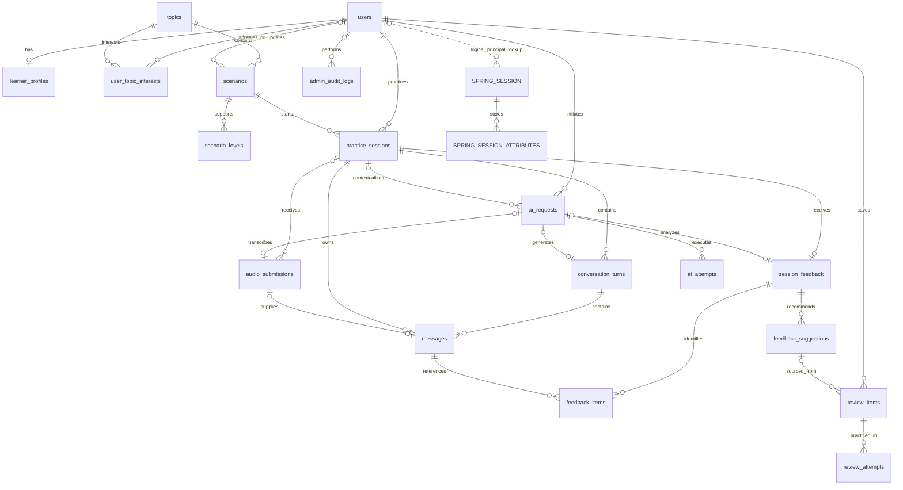

# MySQL, ERD và thiết kế dữ liệu

ERD 20 bảng đã triển khai qua Flyway V1–V10. V10 bổ sung `admin_audit_logs` cho thay đổi tài khoản và danh mục. Cấu hình dùng MySQL 8.4, Spring Data JPA/Hibernate và Flyway.

Tài liệu này sở hữu danh mục bảng, quan hệ, ràng buộc và chính sách dữ liệu. Xem [từ điển trường](database-dictionary.md), [workflow](database-workflows.md), [yêu cầu](../product/requirements.md) và [ADR 0003](../decisions/0003-database-design.md).

## Danh mục 20 bảng

| Nhóm | Bảng | Vai trò |
| --- | --- | --- |
| Tài khoản | users | Đăng nhập, vai trò, trạng thái tài khoản |
| Tài khoản | learner_profiles | Hồ sơ, trình độ tự chọn và mục tiêu |
| Cá nhân hóa | user_topic_interests | Quan hệ người học – chủ đề quan tâm |
| Nội dung | topics | Chủ đề giao tiếp |
| Nội dung | scenarios | Tình huống, vai trò, mục tiêu, hướng dẫn AI |
| Nội dung | scenario_levels | Trình độ được hỗ trợ của tình huống |
| Hội thoại | practice_sessions | Buổi luyện, chủ sở hữu và snapshot |
| Hội thoại | conversation_turns | Thứ tự, chống trùng và trạng thái từng lượt |
| Hội thoại | messages | Nội dung người học/AI đã được chấp nhận |
| Giọng nói | audio_submissions | Audio tạm, transcript chờ xác nhận và dọn file |
| Phản hồi | session_feedback | Nhận xét chung và trạng thái phân tích |
| Phản hồi | feedback_items | Từng lỗi hoặc đề xuất diễn đạt, gắn câu nguồn |
| Phản hồi | feedback_suggestions | Từ/mẫu câu được đề xuất để ôn |
| Ôn tập | review_items | Nội dung người học thực sự chọn lưu |
| Ôn tập | review_attempts | Lịch sử từng lần ôn |
| Vận hành | ai_requests | Tác vụ AI logic và chống tạo trùng |
| Vận hành | ai_attempts | Từng lần gọi provider, lỗi, usage và độ trễ |
| Vận hành | admin_audit_logs | Truy vết thao tác quản trị |
| Phiên đăng nhập | SPRING_SESSION | Mã phiên, principal, thời điểm truy cập/hết hạn |
| Phiên đăng nhập | SPRING_SESSION_ATTRIBUTES | Thuộc tính phiên do Spring Session JDBC quản lý |

15 bảng nghiệp vụ, 3 bảng vận hành và 2 bảng hạ tầng phiên. `ai_requests` + `ai_attempts` thay đề xuất ai_request_logs cũ. Đã chọn Session tại [ADR 0004](../decisions/0004-session-authentication.md); không có bảng refresh token/JWT. Runtime hiện có 18 bảng theo [P5](../development/phase5/README.md) và Spring Session JDBC 4.1.1.

## ERD logic

Sơ đồ mô tả cardinality ở mức lưu trữ. Tình huống nháp có thể chưa có scenario_levels; khi chuyển ACTIVE phải có ít nhất một level. Một ai_request chỉ gắn với một loại đối tượng theo task_type, không đồng thời gắn cả turn/audio/feedback. Đường users–scenarios gộp hai FK created_by/updated_by để dễ đọc. Audio có thể tạm không còn session khi đang chờ dọn file sau xóa lịch sử.

ADR 0005 bổ sung HINT: ai_requests chỉ gắn session, trả gợi ý tạm, không tạo turn/message hoặc lưu response vào log. Không tăng số bảng; giới hạn 20 lượt vẫn chỉ tính câu LEARNER được chấp nhận.

Đường chấm users–SPRING_SESSION chỉ là lookup logic qua PRINCIPAL_NAME (chuỗi users.id), không FK vật lý. Principal có thể NULL trước đăng nhập. SPRING_SESSION_ATTRIBUTES có FK thật tới SPRING_SESSION.PRIMARY_ID, xóa theo CASCADE của schema thư viện.

## Quy ước vật lý

- InnoDB, utf8mb4. Chọn collation theo loại trường: mã trạng thái/operation key cần so sánh chính xác; nội dung tiếng Việt dùng collation phù hợp.
- ID tự tăng BIGINT có dấu, tương ứng Java Long; ID trong JSON API biểu diễn chuỗi để tránh mất chính xác phía JavaScript.
- Thời gian DATETIME(6), ghi UTC; thống kê ngày luyện theo Asia/Ho_Chi_Minh như quy ước sản phẩm. Không nhầm giá trị DATETIME tự mang múi giờ.
- Hai bảng Spring Session là ngoại lệ quy ước ứng dụng: ID CHAR(36), tên cột uppercase, thời điểm BIGINT epoch milliseconds, idle interval INT giây và thuộc tính BLOB theo schema MySQL của thư viện; không đổi thành BIGINT ID/DATETIME chỉ để đồng dạng.
- Status/role/level dùng VARCHAR + CHECK khi triển khai; Java enum lưu tên. NOT NULL riêng, không trông chờ CHECK để cấm NULL.
- version dùng BIGINT cho optimistic locking; không thay thế khóa/giao dịch cần thiết để điều phối nhiều bản ghi.
- JSON chỉ cho snapshot, danh sách mô tả và metadata không cần quan hệ. Nội dung cần filter/thống kê/FK dùng cột/bảng riêng.
- Không lưu secret, audio BLOB hoặc hội thoại thô trong log. Prompt snapshot không chứa key, không trả hướng dẫn nội bộ qua API người học.
- Độ dài, kiểu và nullable cụ thể trong [dictionary](database-dictionary.md) là thiết kế đề xuất, phải xác minh cùng JPA/MySQL khi tạo migration.

## Khóa duy nhất và chỉ mục

| Bảng | Ràng buộc/chỉ mục chính |
| --- | --- |
| users | UNIQUE(email) sau chuẩn hóa thống nhất |
| learner_profiles | PK(user_id), cũng là FK |
| user_topic_interests | PK(user_id, topic_id); index(topic_id, user_id) nếu cần truy vấn ngược |
| topics / scenarios | UNIQUE(code) |
| scenario_levels | PK(scenario_id, level); index(level, scenario_id) |
| practice_sessions | index(user_id, started_at, id), index(user_id, status, started_at) |
| conversation_turns | UNIQUE(session_id, turn_no), UNIQUE(session_id, client_request_id), UNIQUE(session_id, id), UNIQUE(ai_request_id); index(session_id, status) |
| messages | UNIQUE(turn_id, sender), UNIQUE(session_id, id), UNIQUE(audio_submission_id); index(session_id, created_at, id) |
| audio_submissions | UNIQUE(session_id, client_request_id), UNIQUE(session_id, id), UNIQUE(ai_request_id), UNIQUE(storage_key). Chỉ mục riêng cho hạn audio, hạn nháp và status |
| session_feedback | UNIQUE(session_id), UNIQUE(session_id, id), UNIQUE(ai_request_id) |
| feedback_items | index(feedback_id, sort_order), index(session_id, source_message_id) |
| feedback_suggestions | index(feedback_id, sort_order) |
| review_items | index(user_id, status, next_review_at), UNIQUE(user_id, source_suggestion_id) |
| review_attempts | index(review_item_id, reviewed_at) |
| ai_requests | UNIQUE(user_id, task_type, operation_key), index(user_id, created_at), index(session_id) |
| ai_attempts | UNIQUE(ai_request_id, attempt_no); thêm index theo truy vấn báo cáo thực tế |
| admin_audit_logs | index(actor_user_id, created_at), index(target_type, target_id, created_at) |
| SPRING_SESSION | PK(PRIMARY_ID), UNIQUE(SESSION_ID), index(EXPIRY_TIME), index(PRINCIPAL_NAME) theo schema thư viện |
| SPRING_SESSION_ATTRIBUTES | PK(SESSION_PRIMARY_ID, ATTRIBUTE_NAME), FK SESSION_PRIMARY_ID → SPRING_SESSION.PRIMARY_ID ON DELETE CASCADE |

Các UNIQUE trên FK nullable cho phép nhiều hàng không có liên kết; chúng ngăn dùng cùng một liên kết có giá trị cho hai đối tượng. Tránh tạo index trùng nếu PK/UNIQUE đã đáp ứng truy vấn.

## Toàn vẹn và điều phối

1. `messages(session_id, turn_id)` tham chiếu `conversation_turns(session_id, id)`; `messages(session_id, audio_submission_id)` tham chiếu `audio_submissions(session_id, id)` khi có audio.
2. `feedback_items(session_id, feedback_id)` tham chiếu `session_feedback(session_id, id)`; `(session_id, source_message_id)` tham chiếu `messages(session_id, id)`. Giữ session_id có chủ đích để FK kiểm tra cùng buổi.
3. Backend kiểm tra nguồn feedback là tin nhắn LEARNER, original_text thuộc nội dung nguồn; FK không chứng minh tính đúng ngữ pháp hoặc sender của nguồn.
4. Chỉ tin nhắn LEARNER có audio; LEARNER_TEXT tạo input_type TEXT, LEARNER_AUDIO tạo AUDIO, ASSISTANT dùng GENERATED. Opening chỉ có ASSISTANT; lượt thành công thông thường có đúng một LEARNER và một ASSISTANT. Ràng buộc xuyên bảng do service thực hiện.
5. OPENING dùng turn_no 0, lượt người học từ 1. Sắp hội thoại theo turn_no, LEARNER trước ASSISTANT; không chỉ dựa timestamp có thể trùng.
6. Khi nhận lượt mới, khóa session và kiểm tra còn ACTIVE, không có lượt PENDING/RUNNING/UNKNOWN cần giải quyết. Cấp turn_no và kiểm tra idempotency trong transaction ngắn. Không gọi provider trong DB transaction.
7. Cùng client_request_id nhưng fingerprint khác phải bị từ chối. HMAC/fingerprint không thay việc kiểm tra quyền. Không gửi lại tác vụ UNKNOWN một cách mù quáng; không cam kết exactly-once cho dịch vụ ngoài.
8. Retry feedback chỉ dùng bản PENDING/FAILED hiện có; kết quả SUCCEEDED được tái sử dụng. Nếu sau này cho tái sinh phản hồi đã thành công, phải thiết kế versioning nguồn trước, không ghi đè tùy tiện.
9. Backend xác nhận owner của mọi source khi lưu review, đối chiếu task_type/owner/session của ai_request liên kết. Không tin FK hợp lệ đồng nghĩa người dùng có quyền.
10. Cập nhật kết quả AI chỉ được commit nếu buổi/đối tượng vẫn còn và trạng thái cho phép. Worker muộn không được tái tạo dữ liệu sau xóa hoặc ghi đè kết quả mới.

## Chính sách vòng đời và xóa

| Đối tượng/thao tác | Thiết kế áp dụng |
| --- | --- |
| Ẩn topic/scenario | Tắt/ARCHIVED; không hard-delete catalog đang được tham chiếu. FK từ buổi tới scenario dùng RESTRICT |
| Khóa users | Giữ dữ liệu, revoke mọi Spring Session của principal; request bảo vệ tiếp theo phải kiểm tra users.status, không chỉ tin context cũ |
| Logout/hết hạn | Vô hiệu hóa phiên hiện tại hoặc từ chối phiên hết hạn; cleanup JDBC xóa attributes theo FK. Không xóa buổi luyện khi logout |
| Xóa một buổi | Xóa nội dung buổi, turns/messages, feedback/items/suggestions; thực hiện thứ tự FK trong transaction, không mặc định cascade mọi liên kết |
| review_items đã lưu | Giữ bản sao thuộc người học, source_suggestion_id SET NULL trước hoặc khi xóa nguồn; UI phải thông báo việc giữ mục ôn |
| Xóa toàn bộ dữ liệu học tập | Xóa cả mục ôn và review_attempts; không chỉ xóa session |
| Log AI khi xóa buổi | ai_requests.session_id SET NULL; không chứa nội dung hội thoại. Giữ theo retention được chốt trước release |
| Audio sau xóa buổi | Trong transaction xóa, xóa transcript, chuyển DELETION_PENDING và gỡ session_id. Giữ storage_key cần dọn. Hàng đã gỡ liên kết nằm ngoài phạm vi API người học |
| Dọn file | Worker quét DELETION_PENDING kể cả session_id NULL. Chỉ gỡ storage_key sau khi xóa file local thành công hoặc file đã vắng mặt. WAV được gửi inline nên không sinh đối tượng Files API |
| Kết thúc dọn | Khi mọi đích do ứng dụng quản lý đã được xử lý, đặt audio_deleted_at; tombstone không còn buổi có thể xóa hẳn. Không hứa mọi bản sao nội bộ provider cũng biến mất |
| admin_audit_logs | Actor có thể SET NULL khi chính sách xóa tài khoản được triển khai; không lưu PII trong safe_metadata. target_id là dấu vết lịch sử, không FK đa hình |

FK ghép audio/session không dùng SET NULL một cách làm NULL cả session_id của messages. Xóa/detach theo thứ tự service: xử lý feedback nguồn, messages rồi audio/session. Chọn CASCADE/RESTRICT cụ thể khi viết DDL và kiểm thử các đường xóa; không tắt FOREIGN_KEY_CHECKS để vượt ràng buộc.

Soft delete đơn thuần không đáp ứng xóa nội dung đã cam kết. ADR 0006 chốt audio 1 giờ từ upload, transcript nháp 30 phút từ READY, log AI 30 ngày và backup hằng ngày giữ 7 ngày; cleanup 5 phút. Đây là chính sách ứng dụng, không cam kết xóa mọi bản sao provider đúng mốc. Xóa tài khoản và quota còn mở. Xóa DB/file ngoài không nguyên tử; tombstone phục vụ dọn có thể chạy lại.

## Thống kê và cá nhân hóa

- Số buổi: session COMPLETED; chỉ hoàn thành bình thường sau ít nhất một câu LEARNER được chấp nhận. Thoát ngay hoặc bỏ dở dùng ABANDONED. ADR 0005 giới hạn tối đa 20 câu LEARNER/buổi; opening/HINT/retry không tăng số này.
- Lượt người học: đếm messages.LEARNER đã chấp nhận, kể cả AI sau đó thất bại; retry không tạo bản sao. Không đếm opening hoặc attempt API là lượt học.
- Ngày luyện: ngày có câu LEARNER được chấp nhận, đổi UTC sang múi giờ thống kê. Chưa tính thời gian học chính xác từ chênh started_at/ended_at vì có thể người học để tab mở.
- Lỗi thường gặp: feedback SUCCEEDED, item_type ERROR; nhóm theo category và rule_code được backend kiểm soát. Không gộp IMPROVEMENT thành lỗi.
- Gợi ý: selected_level + user_topic_interests + lịch sử + review_items. Chưa cần vector DB hoặc bảng thống kê tổng hợp.
- Xóa lịch sử làm thay đổi thống kê nguồn; giao diện cần giải thích. Bản sao review được giữ không tái tạo lịch sử đã xóa.

## Phạm vi còn mở và triển khai

Không thêm bảng lớp học, thanh toán, chứng chỉ hoặc phát âm. Session JDBC/MySQL, idle 30 phút, email trim/case-insensitive đã chốt; AUTH-01 đã có dependency, Flyway schema, vòng đời phiên/CSRF và kiểm thử MySQL; xem [kết quả P1](../development/phase1/README.md). Bản đầu chỉ FLASHCARD; điền từ/lịch ôn tự động để sau theo ADR 0005. Goal phút/ngày không mặc định tạo UI nhắc ôn.

Retention và browser đã chốt tại [ADR 0006](../decisions/0006-phase0-operating-decisions.md) và [chính sách chi tiết](../product/data-and-browser-proposal.md), chưa triển khai job. TTL transcript dùng transcript_expires_at riêng, TTL file dùng expires_at; không tăng số bảng. Metadata log purge phải gỡ FK hợp lệ mà không làm tác vụ hoàn tất bị gọi lại; backup/restore cần áp lại yêu cầu xóa trước mở dịch vụ.

Migration theo nhóm nghiệp vụ đã được giao, không tạo SQL rỗng hoặc tự chạy DDL chỉ để khớp ERD. Flyway sở hữu schema thực tế sau này; Hibernate dùng validate. Cần kiểm thử bằng MySQL trên DB rỗng và đường nâng cấp có dữ liệu, FK cùng buổi, chống trùng/cạnh tranh, xóa và worker muộn. H2 và profile bootstrap không chứng minh MySQL hoạt động.

## Tài liệu tham chiếu

- [MySQL 8.4 foreign keys](https://dev.mysql.com/doc/refman/8.4/en/constraint-foreign-key.html)
- [MySQL 8.4 CHECK](https://dev.mysql.com/doc/refman/8.4/en/create-table-check-constraints.html)
- [MySQL 8.4 JSON](https://dev.mysql.com/doc/refman/8.4/en/json.html)
