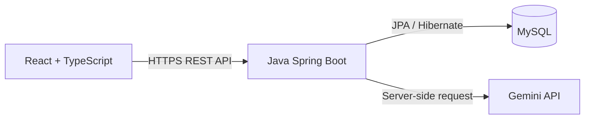

# Kiến trúc tổng thể

Frontend và backend dùng Session JDBC/MySQL. Các module hồ sơ, catalog, hội thoại, phản hồi, ôn tập và lịch sử có trong ứng dụng. [Giọng nói theo lượt](../development/phase6/README.md) bổ sung bản chép lời cần xác nhận và playback cục bộ. Xem [ADR 0007](../decisions/0007-auth-implementation.md) cho xác thực.

Backend là một ứng dụng chia module nghiệp vụ; chưa cần microservices. Frontend không gọi Gemini trực tiếp. Database không truy cập từ trình duyệt.

## Ranh giới
- Frontend: tương tác, ghi âm, bản chép lời xác nhận, phát câu AI.
- Backend: phiên người dùng, phân quyền, chủ sở hữu dữ liệu, giới hạn, lưu trữ và gọi AI.
- Gemini: sinh hội thoại, chép lời bằng mô hình phù hợp và phân tích; đầu ra không đáng tin cho tới khi kiểm tra.
- MySQL: dữ liệu quan hệ; không lưu audio gốc như blob mặc định.

## Tài liệu chuyên biệt
[Backend](backend.md), [frontend](frontend.md), [database](database.md), [AI](ai-integration.md).

## Nguồn sự thật
Yêu cầu sản phẩm sở hữu hành vi mong muốn. ADR sở hữu quyết định và lý do. Khi có ứng dụng: migration sở hữu schema triển khai, cấu hình build sở hữu dependency, OpenAPI sinh từ code sở hữu hợp đồng API hiện hành. Nếu khác tài liệu, nêu khác biệt và xác định hành vi đúng trước khi cập nhật; không tự coi code lỗi là yêu cầu.
