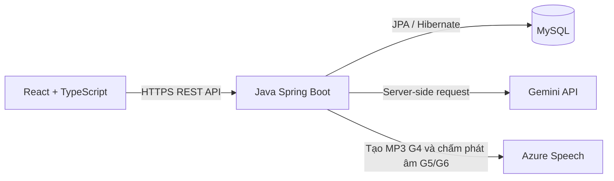

# Kiến trúc tổng thể

G4 dùng Azure Speech Text to Speech F0. G5 chọn Azure Pronunciation Assessment cho bài chấm theo mẫu. G6 tích hợp chấm lời nói tự do theo lượt bằng Azure UNSCRIPTED khi được bật. [ADR 0014](../decisions/0014-azure-speech-tts-g4.md) · [ADR 0015](../decisions/0015-azure-pronunciation-assessment-g5.md)

Thiết kế dùng React, Spring Boot và Session JDBC/MySQL. Khi chạy Maven, profile `g6` mở các nhóm đã triển khai đến luyện hội thoại. Profile `bootstrap` phục vụ kiểm tra health. [Kế hoạch 10 nhóm](../development/full-system-implementation-plan.md)

Backend là một ứng dụng chia module nghiệp vụ; chưa cần microservices. Frontend không gọi Gemini trực tiếp. Database không truy cập từ trình duyệt.

## Ranh giới
- Frontend: tương tác, ghi âm, bản chép lời xác nhận, phát câu AI.
- Backend: phiên người dùng, phân quyền, chủ sở hữu dữ liệu, giới hạn, lưu trữ và gọi AI.
- Gemini: sinh hội thoại, chép lời bằng mô hình phù hợp và phân tích; đầu ra không đáng tin cho tới khi kiểm tra.
- MySQL: dữ liệu quan hệ; không lưu audio gốc như blob mặc định.

## Tài liệu chuyên biệt
[Backend](backend.md), [frontend](frontend.md), [database](database.md), [AI](ai-integration.md).

[Thiết kế MySQL 46 bảng](database.md) trình bày phạm vi schema khởi tạo, ERD, từ điển và workflow. [ADR 0012](../decisions/0012-system-database-scope.md) ghi quyết định phạm vi.

## Nguồn sự thật
Yêu cầu sản phẩm sở hữu hành vi mong muốn. ADR sở hữu quyết định và lý do. Khi có ứng dụng: migration sở hữu schema triển khai, cấu hình build sở hữu dependency, OpenAPI sinh từ code sở hữu hợp đồng API hiện hành. Nếu khác tài liệu, nêu khác biệt và xác định hành vi đúng trước khi cập nhật; không tự coi code lỗi là yêu cầu.

## Kiến trúc bổ sung

[quy tắc sản phẩm bổ sung](../decisions/0005-initial-product-rules.md) mô tả token email, SMTP outbox, lịch/worker nhắc học, avatar storage và job xóa tài khoản. Đã có implementation; SMTP ngoài hệ thống và storage triển khai cần cấu hình/nghiệm thu riêng. Session JDBC và backend kiểm tra chủ sở hữu tiếp tục áp dụng.
